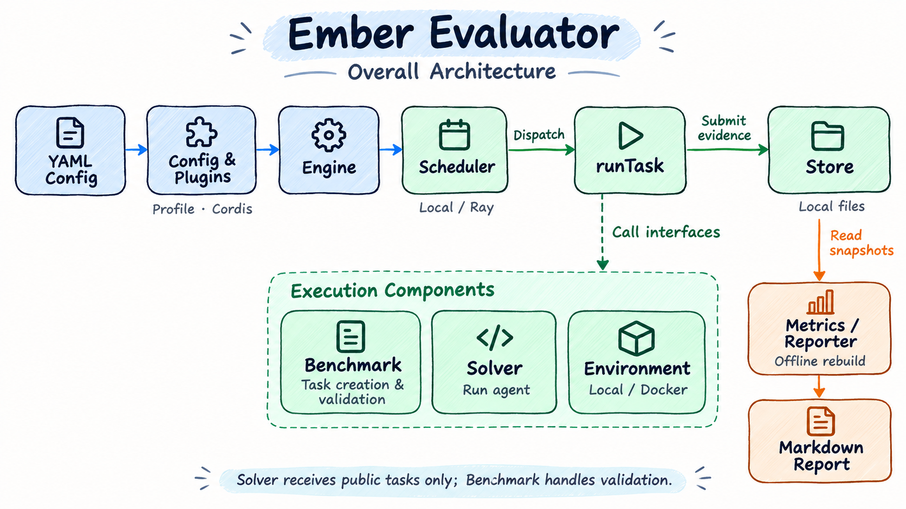

<h1 align="center">
  
</h1>

<h3 align="center">多种评测方法，一个框架统一承载。</h3>

<p align="center">
  融合 Benchmark、Agent 能力评测与性能测试，覆盖代码、终端、办公、网页等多种场景，统一配置与执行。
</p>

<p align="center">
  
  
  
</p>

<p align="center">
  <a href="./README.md">English</a> | 中文
</p>

<p align="center">
  <a href="docs/users/quick-start.zh-CN.md">快速开始</a> ·
  <a href="docs/users/README.zh-CN.md">使用文档</a> ·
  <a href="playbook/README.md">实验配置</a> ·
  <a href="docs/development/plugins.md">插件开发</a>
</p>

## ℹ️ 简介

Ember Evaluator 用一份 YAML 配置模型、Agent、Benchmark 和执行环境，完成任务执行、答案验证、结果保存和报告生成，帮助你在相同实验条件下比较不同模型与 Agent。

项目支持数学与知识问答、代码修改、终端操作、办公、网页和安全任务；也支持使用 AgentX 回放 Trace，测量模型服务的吞吐与延迟。



模型与 Agent 负责求解，Benchmark 负责验证，Store 保存结果和证据。各模块的职责、调用流程和源码入口见 `src/` 目录。

## ⚙️ 功能介绍

- **多种评测任务**：支持 GSM8K、MMLU、HumanEval、Terminal-Bench、SWE-bench、WorkBuddy、[OfficeQA Pro V2](docs/users/benchmarks/officeqa-pro-v2.zh-CN.md)（默认解析 JSON，也支持原始 PDF）和自有 Harbor 任务，见[支持的 Benchmark](docs/users/README.zh-CN.md#现在能测哪些-benchmark)。
- **多种 Agent 与模型服务**：支持 SimpleAgent 和 AgentBundle（含 Dify Harness），可配置独立裁判模型，见[Solver 与模型服务](docs/users/solvers.zh-CN.md)。
- **本机、容器与分布式执行**：使用 local 或 Docker 执行任务，通过本地 Scheduler 或 Ray 调度，并控制并发和环境准备，见[运行方式](docs/users/usage.zh-CN.md#本地docker-与-ray)和[并发指南](docs/users/concurrency.zh-CN.md)。
- **网络配置**：支持配置代理、数据下载地址、Docker 镜像源和依赖包源，见[网络配置指南](docs/users/network.zh-CN.md)。
- **证据保存与任务续跑**：保存配置、来源版本、轨迹、验证日志和产物，中断后继续未完成任务，见[续跑与结果文件](docs/users/usage.zh-CN.md#续跑与重建报告)。
- **指标与离线报告**：统计得分、正确率、耗时和 token usage，从已保存结果重建 Markdown 报告，见[结果阅读](docs/users/usage.zh-CN.md#如何读结果)和[评分口径](docs/users/reference/scoring.zh-CN.md)。
- **模型服务性能测量**：用 AgentX 测量吞吐、TTFT、ITL 和请求延迟，可选采集 vLLM 与 Ascend NPU 指标，见[AgentX 指南](docs/users/benchmarks/agentx.zh-CN.md)。
- **插件扩展**：可替换或新增 Benchmark、Verifier、Solver、Environment 等八类组件，见[插件开发与加载](docs/development/plugins.md)。
- **Node.js SDK**：在业务项目中通过 `Evaluator.run()` 执行评测，支持进度、取消、续跑和 Ray Jobs，见[SDK 指南](docs/users/sdk.zh-CN.md)。

## 📦 安装部署

环境要求：

1. **Node.js** >= 24.22.1（24.x）。
2. **pnpm** >= 11 < 13。没有 pnpm 时，先执行 `npm install --global pnpm`。
3. **Git**，用于拉取 AgentBundle 依赖。

在 Evaluator 仓库根目录执行：

```bash
pnpm install --frozen-lockfile
pnpm build
pnpm add -g .
ember-evaluator --help
```

看到帮助信息即安装成功。详细步骤见[安装指南](docs/users/installation.zh-CN.md)，Linux 服务器也可使用[管理容器](docs/users/deployment/container-toolbox.zh-CN.md)。

## 🚀 快速入门

下面使用 SimpleAgent 在本机运行两道 GSM8K 数学题，无需 Docker。将模型名、API 地址和密钥替换为自己的值，在仓库根目录执行（Bash）：

```bash
export MODEL_NAME="your-model-id"
export MODEL_ENDPOINT="https://your-model-service.example/v1"
export MODEL_API_KEY="your-api-key"

ember-evaluator inspect playbook/gsm8k/gsm8k-quick-start.yaml
ember-evaluator run playbook/gsm8k/gsm8k-quick-start.yaml
```

先用 `inspect` 检查配置文件并查看展开后的实验与网络配置，确认无误后再执行 `run`。

模型服务需支持 OpenAI Chat Completions 和工具调用。运行结束后，打开日志所示结果目录中的 `report.md`。PowerShell 用法及更多说明见[两题快速上手](docs/users/quick-start.zh-CN.md)。

| 评测目标 | Benchmark / 场景 | 执行环境 | 额外条件 | 快速入门 |
| --- | --- | --- | --- | --- |
| 跑通模型与报告链路 | GSM8K，两道题 | local | 支持工具调用的模型 API | [两题快速上手](docs/users/quick-start.zh-CN.md) |
| 评测终端操作能力 | Terminal-Bench 4.0 | Docker | amd64 镜像；ARM64 需 QEMU/binfmt | [Terminal-Bench 4.0 入门](docs/users/quick-start/terminalbench.zh-CN.md) |
| 模型服务标准性能测评 | AgentX standard | local，可选管理容器 | Python 3.11–3.13、venv、tokenizer、长上下文流式模型服务；管理镜像已提供 Python | [AgentX 性能入门](docs/users/quick-start/agentx.zh-CN.md) |

其他题库和运行组合见 [Playbook 示例](playbook/README.md)，续跑、报告和日常操作见[用户文档](docs/users/README.zh-CN.md)。

## 🔥 评测前预热镜像

使用 Docker 执行任务时，先用 `warmup` 下载或构建镜像、安装依赖，正式评测时即可复用。以下示例使用同一份实验 YAML，依次检查环境、预热镜像和开始评测：

```bash
ember-evaluator doctor playbook/terminalbench/terminalbench-4.0.yaml
ember-evaluator warmup playbook/terminalbench/terminalbench-4.0.yaml
ember-evaluator run playbook/terminalbench/terminalbench-4.0.yaml
```

先处理 `doctor` 报告的失败项，再执行 `warmup`。预热会准备所选任务的解题、验证和服务镜像，以及 Evaluator 运行时和 Solver 依赖；不调用模型、不执行题目，也不生成评测报告。

预热不要求模型 API key，但模型名称、端点等配置仍需有效。正式评测时补齐模型认证信息，并保持任务版本、选题、平台、插件配置和 Docker daemon 一致，以复用镜像缓存。

本机 Docker、Ray Client 和 Ray Jobs 均支持预热；Ray 在实际执行节点上准备镜像。完整参数和前置条件见[镜像预热指南](docs/users/usage.zh-CN.md#只预热镜像不开始测评)。

### 📥 从 ModelScope 下载评测镜像

**Ember Evaluator 支持从 ModelScope 下载任务镜像归档并自动加载到 Docker。** 配置归档来源后，`warmup` 和 `run` 会按选中的任务、平台和解题／验证阶段获取镜像。也支持 Hugging Face 镜像归档。

> **官方镜像仓库：[evolving-foundry/ember-evaluator](https://www.modelscope.cn/datasets/evolving-foundry/ember-evaluator)**
>
> 由 Ember Evaluator 官方维护，存放部分 Benchmark 的官方任务镜像归档。可用任务和平台以仓库目录为准。

## 📖 使用指南

按操作目标阅读对应文档：

- **配置实验**：[YAML、Profile 与环境变量](docs/users/config.zh-CN.md)；[Solver、AgentBundle 与独立 Judge](docs/users/solvers.zh-CN.md)。
- **运行不同任务**：[Benchmark 场景指南](docs/users/benchmarks/README.zh-CN.md)；[各 Benchmark 的实验配置](playbook/README.md)。
- **管理评测过程**：[选题、续跑与报告](docs/users/usage.zh-CN.md)；[只预热镜像](docs/users/usage.zh-CN.md#只预热镜像不开始测评)；[删除评测镜像](docs/users/usage.zh-CN.md#删除评测镜像)；[并发、准备流水线与超时](docs/users/concurrency.zh-CN.md)。
- **测量服务性能**：[AgentX 并发扫描、Trace 回放与指标采集](docs/users/benchmarks/agentx.zh-CN.md)。
- **扩展项目**：[插件开发与加载](docs/development/plugins.md)；接入数据集见 [Benchmark 评测要求与验收指南](docs/development/benchmark-evaluation-requirements.md)，编写 Benchmark 插件见 [Benchmark 开发指南](docs/development/benchmarks.md)。
- **排查问题**：[下载、日志与模型截断](docs/users/faq/README.zh-CN.md)；[错误码](docs/users/reference/errors.zh-CN.md)；[网络失败补测](docs/users/network-retry.zh-CN.md)。

全部指南、Benchmark 列表和运行限制见[用户文档目录](docs/users/README.zh-CN.md)。

## 🧪 支持的 Benchmark

按评测功能分为三类：

| 类别 | 支持的 Benchmark | 评测内容与使用说明 |
| --- | --- | --- |
| 模型 + Agent Harness 能力测评 | GSM8K、MATH-500、MGSM、MMLU、MMLU-Pro、GPQA、DROP、TriviaQA、SimpleQA、HealthBench、HumanEval、DeepSWE、SWE-bench Verified、Terminal-Bench、WorkBuddy、OfficeQA Pro V2，以及自有 Harbor 任务包 | 覆盖数学、知识问答、代码生成与修改、终端、办公、网页和安全任务，按各题库规则计算正确率或得分。见 [Benchmark 列表与使用条件](docs/users/README.zh-CN.md#现在能测哪些-benchmark)和 [Playbook 配置](playbook/README.md)。 |
| 推理引擎性能测评（AgentX） | AgentX（`agentx`） | 回放 Agent Trace，测量吞吐、TTFT、ITL 和请求延迟，可选采集 vLLM 与 Ascend NPU 指标。见 [AgentX 指南](docs/users/benchmarks/agentx.zh-CN.md)。 |
| 算子性能测评（kernel） | kernel（`kernel`） | 在 Ascend NPU 上验证已有候选算子的正确性，测量参考与候选耗时、加速比，并可采集详细硬件性能指标；本地串行执行，不调用模型。见 [kernel 指南](docs/users/benchmarks/kernel-npu.zh-CN.md)和[配置示例](playbook/kernel/existing.yaml)。 |

## 📊 评测结果

以下成绩按模型与 Agent Harness 组合记录，空白单元格表示暂未发布成绩；比较时需同时核对文档输入、题目范围和评分条件。

| 模型＋Agent Harness | GSM8K | MMLU | WorkBuddy | Terminal-Bench 4.0 | SWE-bench Verified | OfficeQA Pro V2 |
| --- | --- | --- | --- | --- | --- | --- |
| DeepSeek V4.1 Flash 1017＋SimpleAgent | 92.34%（1218/1319） |  | 0.8502(Office)，0.9009(Code)，0.7957(Web) |  |  | 56.67%（51/90） |
| DeepSeek V4.1 Flash 1017＋choice-logprobs |  | 88.83%（12,474/14,042） |  |  |  |  |

