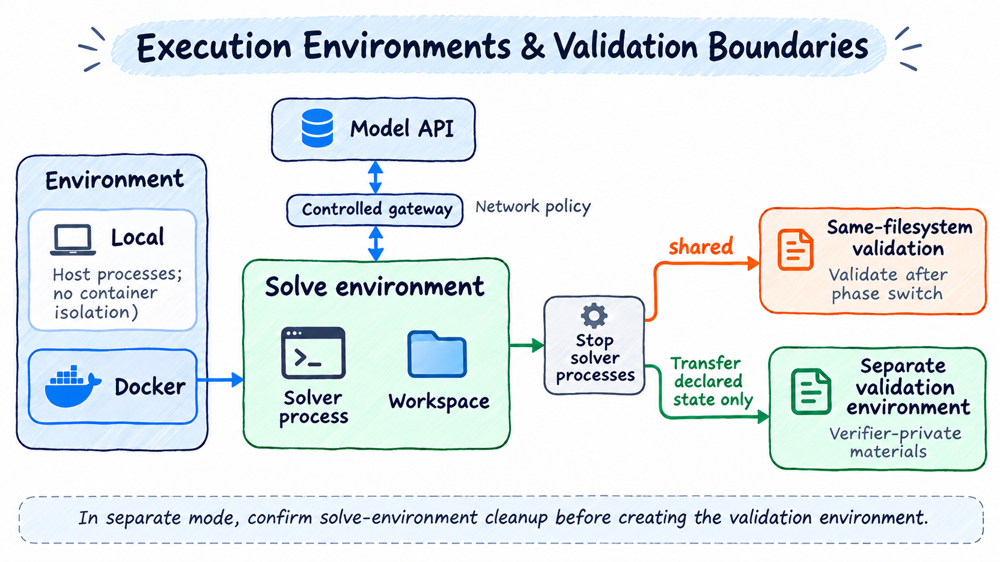

# Integrating Harbor Datasets Through Configuration

> English | [中文](./harbor.zh-CN.md)

Harbor evaluates task directories containing instructions, environment declarations, and verification entry points. This guide covers custom sources, image selection, networking, and file delivery. See [WorkBuddy](workbuddy.md) for scenarios and judge requirements.

## Add a Dataset with YAML Only

For datasets containing `tasks/<directory>/task.toml`, `instruction.md`, `environment/`, and `tests/`, configure a pinned archive:

```yaml
benchmark:
  name: harbor
  config:
    dataset: example@1.0
    source:
      kind: archive
      url: https://example.org/example-1.0.tar.gz
      sha256: <64-character archive SHA-256>
      root: example-1.0
    tasks:
      root: tasks
      id: task.name
      expectedCount: 100
    defaults:
      workdir: /workspace
    scoring:
      primary: reward
      passThreshold: 1
      errorValues: [-1]
  verifier: { name: harbor-shell }
  solver: { name: simpleagent, service: default }
```

Combine this fragment with existing `services`, `environment: { name: docker }`, scheduling, and output. Copy [single-machine DeepSWE](../../../playbook/deepswe/deepswe-simpleagent.yaml), [WorkBuddy Code](../../../playbook/workbuddy/workbuddy-code-simpleagent.yaml), or [WorkBuddy Office](../../../playbook/workbuddy/workbuddy-office-ray.yaml) and change the source.

Omitting `source` uses the Harbor registry and `dataset` identifier. Other sources:

```yaml
# Pin a GitHub commit; path selects the dataset directory in the repository
source:
  kind: github
  repository: owner/repository
  revision: <40-character commit>
  path: tasks
  # Optional repository-relative exclusions for unrelated documents/directories.
  # exclude: [tasks/README.md]
tasks: { root: ., id: metadata.task_id }
```

```yaml
# Local directories are single-machine only; paths are relative to experiment YAML
source: { kind: local, path: ./dataset }
```

`tasks.id` supports `directory`, `task.name`, and `metadata.task_id`. `tasks.requireTestScript: true` excludes directories without `tests/test.sh`, recording exclusions/reasons in the source lock. Declare descriptive extensions with `tasks.metadataFields: [field-name]`, such as WorkBuddy Code `v2_1_changes`. This does not bypass execution checks such as multi-step support.

GitHub `source.exclude` matches exact repository-relative paths and their descendants and participates in source identity digests. DeepSWE excludes upstream `tasks/README.md` documentation links. Non-excluded symlinks/submodules remain errors; regular files still undergo Git blob verification.

On native Linux/WSL filesystems, Git materialization restores regular files to `644`, executables to `755`, and internal directories to `755`, independent of restrictive launch `umask`. Archives retain declared permissions; local sources retain existing permissions. Old remote snapshots have permissions repaired only after content validation; outer caches remain private. Docker build copies preserve permissions, and file/directory permission changes create new task image cache identities without changing content source locks. Task Dockerfiles still control `USER`, `chmod`, and `chown`. No per-benchmark permission setting is needed; do not bypass access errors with recursive `chmod 777`.

## Execution and Verification Boundaries

Supports legacy Harbor `version = "1.0"` or omitted version, and Linux tasks with nonempty `schema_version`. Shell verifier ordered `[[steps]]` use per-step instructions, public workdir, tests, deadlines, reward thresholds, and `mean`/`final` aggregation. Shared tests upload first, then step tests overwrite them; workspaces persist while private verification materials are removed between steps. Unsupported fields such as Python multi-step verifiers and step healthchecks are rejected. Version markers remain metadata; capabilities are checked individually. TOML supplies resources, variables, and deadlines; YAML `defaults` fills omissions. Set `defaults.workdir` when the directory cannot be determined statically.

All `harbor` benchmarks share image selection without separate pull implementations:

| Environment | Selection order |
| --- | --- |
| Solve main container | `environment.docker_image` → Compose `main.image` → Compose `main.build` → `environment/Dockerfile` |
| Separate verification main container | `verifier.environment.docker_image` → private Compose `main.image` → private Compose `main.build` → `tests/Dockerfile`; reuse solve definitions if no private environment exists |
| Compose sidecar | Service `image` → service `build` |

When Compose declares both image and build, only image is selected; unused build directories need not exist. An explicit main image replaces only the main container, preserving sidecars, dependencies, and healthchecks. Docker reuses platform-compatible local images before pulling. Pull/authentication/platform failures remain errors rather than silently falling back to Dockerfiles. Prebuilt base images may still need Evaluator/Solver runtime layers.

Image pulls, Docker builds, and runtime installs have separate budgets for each task's solve and separate verification environments. Each uses `build_timeout_sec`, falling back to `defaults.buildTimeoutSeconds`, multiplied by `min(effective node preparation concurrency, 10)`. Verifier runtime and separate image preparation share the verification preparation budget. Queueing is excluded; no overall round limit applies unless configured. See [preparation timeouts](../config.md#environment-preparation-timeouts) for precedence, concurrency, and old fields. Timeouts save `ENV_PREPARATION_TIMEOUT`; `onError: continue` allows other tasks. Early preparation does not consume execution budgets. Solving/scoring use run overrides or task declarations, bounded by `run.timeoutSeconds`.

Point profiles at official task data with image declarations, using archive, github, or local sources. Pin release archives with URL, SHA-256, and root. Standard image fields require no extra code; absent declarations use builds. The framework does not guess Docker Hub tags from benchmark names or treat download failure as a missing image. Upstream formats keeping images only in separate manifests require explicit data-adapter mappings first.

Without a separate verification declaration, shared mode retains the filesystem. `verifier.environment` or `environment_mode = "separate"` creates a separate environment using the selection table; separate alone also discovers private definitions. Verification inherits CPU, memory, storage, and platform unless overridden in `verifier.environment`. Private build contexts are verification-only. Dedicated shell images must contain `/tests/test.sh`, which is not overwritten; shared/fallback environments still receive tests during verification. After solving, `verifier.collect` runs and both modes archive declared `artifacts`; separate mode restores them. Artifacts currently require nonoverlapping absolute file/directory paths. Harbor allows missing declared `artifacts`: record them in the manifest, warn `ARTIFACT_COLLECTION_INCOMPLETE`, and continue the official verifier to determine reward without fabricating files/scores. Restore skips missing items and preserves image files. Permission, transfer, digest, and path-safety errors still abort. Docker phase changes stop solve processes and detached children; files persist but agent-started background services are not guaranteed.

Collect only explicitly declared deliverables; `/logs/artifacts` is not appended automatically. Without top-level task `artifacts` or integration collection paths, no deliverables are collected or warnings issued for guessed directories. `artifacts = []` disables collection explicitly. Shared graders can still read generated files; separate verification can start without transfers. Logs, trajectories, and scores remain saved; no collection declaration does not imply no generated files.

Use `benchmark.config.defaults.artifactPaths` only when the protocol explicitly defines a delivery directory. Task `artifacts` takes precedence; an empty array disables defaults and explicitly configured `taskProfiles.extraPaths`. These settings do not change solver workdir or verification rules. Declare accurate paths when retaining deliverables. Missing declared paths still produce `ARTIFACT_COLLECTION_INCOMPLETE`; the official verifier determines reward.

By default, solve timeout is a valid zero without an official verdict. Integrations requiring native scoring after solve failure enable `defaults.scoreAfterSolveFailure: true` to verify the remaining workspace and preserve actual reward and solve error; WorkBuddy Sec enables it. `defaults.timeoutMultiplier` scales task solve/verify limits; explicit run phase limits take precedence. `defaults.agentUser`/`defaults.verifierUser` fill missing users. Before multi-container collection, a stopped main is restarted only through Evaluator's maintenance entry, without replaying task startup; sidecars stay running for `verifier.collect` and snapshots. Collection command failures are recorded; after writers stop, existing files are exported if possible. Failure to stop writers or export remains a collection failure.

`no-network` solving permits only the model gateway; fully offline verification uses none. Docker supports declared Compose groups, healthchecks, dependency conditions, and `network_mode: service:<name>`. Solvers run in `main` without Docker socket access. Compose v2 is required. Main-only configurations support allowlist, model gateway, or offline networking while retaining task `command`/`entrypoint`. Additional task services require bridge networking; incompatible allowlist/isolation combinations are rejected without public-network fallback. SimpleAgent supports public `skills_dir` and HTTP/SSE MCP. GPUs, Windows containers, and unimplemented Compose/step fields remain unsupported.

Workdirs may include runtime-containing parents such as `/opt`; they are not rewritten to `/workspace`. Transfers still cannot include/overwrite runtime directories, so archiving all of `/opt` is prohibited. Declare specific paths such as `/opt/task/output`. `/`, runtime directories themselves, and `/proc`, `/sys`, `/dev` are invalid workdirs.

### Network Policies



Shared and separate are alternative modes. Shared retains files and switches phase; separate exports declared state, confirms solve cleanup, then creates verification. Model gateways follow the selected policy. Local does not provide Docker isolation.

Policies come from `[environment]` baseline, `[agent]` override, and `[verifier]` override. Separate verification prefers `[verifier.environment]` baseline, otherwise inherits `[environment]`, excluding agent overrides. Supports `public`, `no-network`, and domain allowlists:

```toml
[agent]
network_mode = "allowlist"
allowed_hosts = ["pypi.org", "files.pythonhosted.org", "*.pypi.org"]

[verifier]
network_mode = "no-network"
```

`allowed_hosts` is valid only alongside explicit `allowlist` in the same section; absent/empty lists block external task access. Exact domains exclude subdomains; `*.example.org` includes subdomains only, so list the root separately. HTTP/HTTPS use a controlled proxy from isolated containers; model API access has a separate origin/path-limited route. Removing proxy variables does not enable direct internet; programs ignoring proxies cannot access allowed hosts either. Other TCP/UDP protocols, IP/CIDR, URL, port, and path rules are unsupported; invalid rules fail explicitly. Image builds/runtime installs use their independent preparation networking.

Shared transitions stop all solve processes before switching allowlists/disconnecting egress. Changes terminate old connections. Controlled sessions may switch to Docker bridge for `public` verification. A shared session without a gateway cannot add an allowlist later; use separate verification. Local rejects allowlists because it cannot enforce them. Ray nodes use the same Docker capability; rules travel with tasks rather than coordinator-local addresses.

Plugin authors set `EnvironmentSpec.network` to `{ kind: "allowlist", allowedHosts: ["example.org"] }`; verification uses `PreparedTask.verificationNetwork`. This is an environment contract, requiring no benchmark-name branches or component type. [Harbor task documentation](https://github.com/harbor-framework/harbor/blob/main/docs/content/docs/tasks/index.mdx) defines phase networking, and [Terminal-Bench Science contributing rules](https://github.com/harbor-framework/terminal-bench-science/blob/main/CONTRIBUTING.md) permit verifier allowlists. Supported protocol/rule scope is as described above, not every upstream backend capability.

### Verification and File Delivery

Shell verifiers execute dataset `tests/test.sh`, preferring `reward.json` over `reward.txt`. Reward map values must be finite. A nonzero exit with valid reward preserves both exit code and reward. Missing/malformed rewards and configured error sentinels are verification failures rather than ordinary zeros.

Remote solvers must deliver files into the environment. AgentBundle Dify Harness currently returns text without syncing workflow files to EnvironmentSession. Dify Office YAML demonstrates configuration only; full Office file evaluation requires simpleagent or file-capable AgentBundle.

## Ray, Metrics, and Extensions

Ray nodes rematerialize the same pinned source, without coordinator absolute paths. `source.kind: local` is currently unsupported on Ray. Nodes receive selected service credentials separately; public task payloads contain verifier selection and service names only. Custom plugins use Cordis patches and existing version/package digest checks.

`harbor-score` aggregates the main score; `config.dimensions: [f2p, p2p, partial]` aggregates saved reward dimensions with the same valid-task denominator. Missing dimensions in verified results are `null`. Metrics/Markdown support offline rebuilding without judge credentials or reruns. Resume requires matching sources, configuration, and plugin versions.

YAML alone suffices for datasets using existing sources, supported task capabilities, and verifiers. New execution protocols or scoring mechanisms should extend external adapters or register Verifier components, without changing Engine/Solver.

## Progressive Profile Configuration

Select built-in DeepSWE/WorkBuddy profiles through `benchmark.name: deepswe/workbuddy`. Profiles expand to generic Harbor configuration with the same source/scoring. New-format Web uses default service for judging; Office disables model scoring by default. See [progressive configuration](../config.md) for minimal YAML, independent judges, and custom datasets.

[User guide](../README.md) · [Quick start](../quick-start.md)
