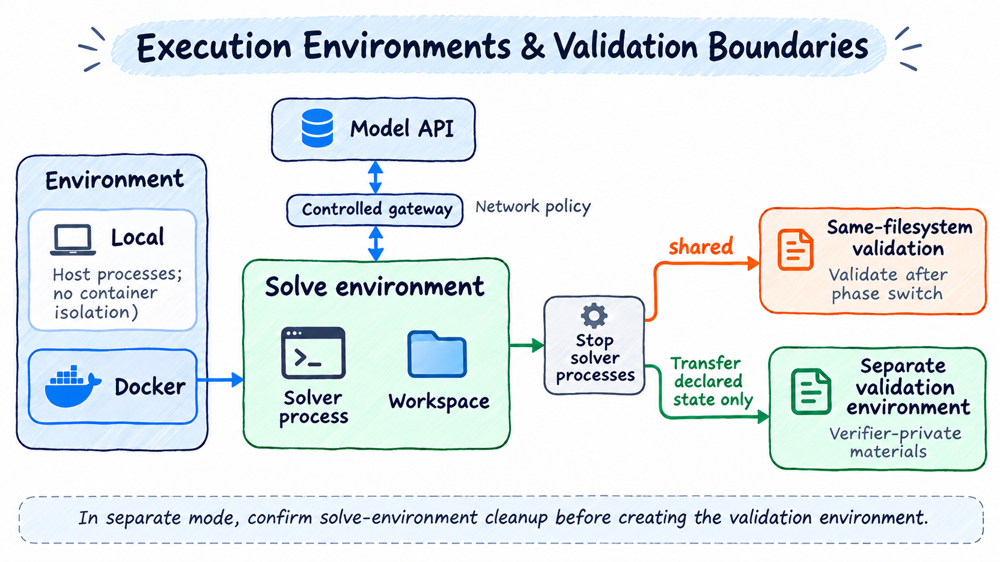

# 用配置接入 Harbor 数据集

> [English](./harbor.md) | 中文

Harbor 数据集通过任务目录中的指令、环境声明和验证入口完成评测。本文说明自定义来源配置、镜像选择、网络和文件交付；WorkBuddy 的场景与裁判要求见[WorkBuddy 指南](workbuddy.zh-CN.md)。

## 任务硬件要求

实验顶层 `hardware` 选择 `npu`（默认）或 `gpu`。题目中的 `gpu`、`gpus`、`gpu_types` 不会被覆盖：选择 NPU 时，GPU 题目报硬件不匹配；选择 GPU 时，报 GPU 任务执行尚未实现。诊断包含题目和声明位置，错误分类为 `BENCHMARK_UNSUPPORTED`，后续处理遵循 `run.onError`。

检查覆盖求解环境、独立验证环境、多阶段任务和可识别的 Compose GPU 声明，在构建镜像或启动任务容器前拒绝。不声明 GPU 的题目保持现有行为；选择 NPU 不会自动挂载设备或移植 CUDA 代码。

## 一个新数据集只增加 YAML

数据集含 `tasks/<目录>/task.toml`、`instruction.md`、`environment/` 和 `tests/` 时，可以配置固定归档：

```yaml
benchmark:
  name: harbor
  config:
    dataset: example@1.0
    source:
      kind: archive
      url: https://example.org/example-1.0.tar.gz
      sha256: <归档的 64 位 SHA-256>
      root: example-1.0
    tasks:
      root: tasks
      id: task.name
      expectedCount: 100
    defaults:
      workdir: /workspace
    scoring:
      primary: reward
      passThreshold: 1
      errorValues: [-1]
  verifier: { name: harbor-shell }
  solver: { name: simpleagent, service: default }
```

以上片段与已有实验的 `services`、`environment: { name: docker }`、调度及输出配置组合。可直接复制 [DeepSWE 单机](../../../playbook/deepswe/deepswe-simpleagent.yaml)、[WorkBuddy Code](../../../playbook/workbuddy/workbuddy-code-simpleagent.yaml) 或 [WorkBuddy Office](../../../playbook/workbuddy/workbuddy-office-ray.yaml) 后修改来源。

省略 `source` 时使用 Harbor registry 和 `dataset` 标识。其他来源为：

```yaml
# 固定 GitHub 提交；path 是仓库内的数据集目录
source:
  kind: github
  repository: owner/repository
  revision: <40 位 commit>
  path: tasks
  # 可选：仓库相对路径，排除与任务无关的文档或目录。
  # exclude: [tasks/README.md]
tasks: { root: ., id: metadata.task_id }
```

```yaml
# 本地目录只用于单机，路径相对实验 YAML
source: { kind: local, path: ./dataset }
```

`tasks.id` 支持 `directory`、`task.name` 和 `metadata.task_id`。`tasks.requireTestScript: true` 筛除没有 `tests/test.sh` 的目录，排除项和原因写入来源锁。描述性扩展字段可以通过 `tasks.metadataFields: [字段名]` 声明，例如 WorkBuddy Code 的 `v2_1_changes`。这不允许绕过多步骤等执行能力检查。

GitHub 来源的 `source.exclude` 精确匹配仓库相对路径及其子目录，并参与来源身份摘要。DeepSWE Profile 用它排除上游的 `tasks/README.md` 文档链接；未排除的符号链接和子模块仍报错，普通文件仍校验 Git blob 摘要。

在 Linux/WSL 原生文件系统中，Git 数据物化按上游可执行标记恢复普通文件 `644`、可执行文件 `755` 和内部目录 `755`，不受启动脚本的严格 `umask` 影响；归档来源保留归档内声明的权限，本地来源保留原目录权限。远端来源的旧快照只有通过内容校验后才修复权限，缓存外层保持私有。Docker 构建副本保留来源权限，文件和目录的权限变化会产生新的任务镜像缓存标识；原有内容来源锁保持不变。任务自己的 `USER`、`chmod`、`chown` 继续由 Dockerfile 决定。无需在每个 Benchmark YAML 中配置权限，也不应通过全目录 `chmod 777` 绕过访问错误。

## 执行与验证边界

支持旧式 Harbor `version = "1.0"` 或省略 version，以及使用非空 `schema_version` 标记的 Linux 任务。支持 shell verifier 的有序 `[[steps]]`：每步读取自己的指令、公开 workdir 和测试，使用步骤时限、奖励门槛及 `mean` / `final` 总分规则。共享测试先上传，步骤测试随后覆盖；步骤间保留工作区并清除私有验证材料。Python verifier 的多步骤、步骤 healthcheck 等尚未实现的字段明确拒绝。版本标记作为元数据保留，具体执行能力仍逐项检查。资源、环境变量和时限来自任务 TOML；YAML 的 `defaults` 补充缺省值。无法静态确定工作目录时，在 YAML 中设置 `defaults.workdir`。

所有使用 `harbor` 的 Benchmark 共用镜像选择规则，不需要各自实现拉取逻辑：

| 环境 | 选择顺序 |
| --- | --- |
| 解题主容器 | `environment.docker_image` → Compose `main.image` → Compose `main.build` → `environment/Dockerfile` |
| 独立验证主容器 | `verifier.environment.docker_image` → 私有 Compose `main.image` → 私有 Compose `main.build` → `tests/Dockerfile`；没有私有环境定义时复用解题环境定义 |
| Compose 侧车 | 该服务的 `image` → 该服务的 `build` |

Compose 同时声明 image 和 build 时只选择 image，不要求未采用的构建目录存在；显式主镜像仅覆盖主容器，仍保留该环境的侧车、依赖与健康检查。Docker 节点优先复用符合平台的本地镜像，缺少时拉取。声明了镜像但拉取失败、认证失败或平台不支持时保留错误，不静默改为 Dockerfile 构建。使用预构建基础镜像后，框架仍可能构建必要的 Evaluator/Solver 运行时层。

镜像拉取、Dockerfile 构建及运行时安装按每题的求解环境和独立验证环境分别限时；对应环境的 `build_timeout_sec` 缺省使用 `defaults.buildTimeoutSeconds`，再乘 `min(本节点有效准备并发, 10)`。验证器 runtime 与独立验证镜像准备共享验证准备预算。排队不计时；默认没有整轮上限，可显式配置。配置优先级、并发计算和旧字段迁移见[环境准备时限](../config.zh-CN.md#环境准备时限)。准备超时保存 `ENV_PREPARATION_TIMEOUT`，`onError: continue` 时可继续其他任务。提前准备不占单题执行预算；求解与评分仍分别使用 run 覆盖值或任务声明，且受 `run.timeoutSeconds` 约束。

接入者只需让 Profile 指向包含镜像声明的官方任务数据：`source.kind` 可使用 archive、github 或 local；发布归档用 URL、SHA-256 和 root 固定。任务包已声明上述镜像字段时无需额外代码；没有镜像声明时沿用构建路径。框架不根据 Benchmark 名称猜测 Docker Hub 标签，也不将来源下载失败等同于“没有镜像”。仅在独立清单中提供镜像、没有写回标准任务数据的上游发布格式，需要先在数据适配层增加该格式的明确映射。

未声明独立验证环境时采用 shared 模式，保留任务文件系统；声明 `verifier.environment` 或 `environment_mode = "separate"` 时创建独立验证环境。验证环境按上表选择镜像或构建定义；只声明 separate 也会发现私有环境定义。独立验证默认继承任务 CPU、内存、存储和平台约束，可在 `verifier.environment` 覆盖。私有构建上下文只供验证环境使用；专属 Shell 验证镜像应内置 `/tests/test.sh`，框架不再上传测试覆盖它；共享与回退环境继续在验证阶段上传测试。求解进程结束后执行 `verifier.collect`，共享和独立模式均归档声明的 `artifacts`，独立模式还将其恢复到验证环境。产物目前支持互不重叠的绝对文件或目录路径；声明的产物按 Harbor 语义允许缺失：缺失项保存在归档清单中并输出 `ARTIFACT_COLLECTION_INCOMPLETE` 警告，仍继续执行官方验证器，由其决定奖励；不会补造文件或分数。恢复时跳过缺失项，保留验证镜像原有文件。读取权限、传输、摘要或路径安全错误仍中止，不能被当作普通缺失忽略。Docker 阶段切换会清理求解进程及其脱离的子进程；当前实现保留文件系统，不保证 Agent 启动的后台服务继续运行。

交付文件只按显式声明收集，不会自动附加 `/logs/artifacts`。任务未声明顶层 `artifacts` 且接入配置没有提供收集路径时，不收集交付文件，也不因某个猜测的目录不存在而警告；`artifacts = []` 显式关闭交付文件收集。共享容器中的 grader 仍可读取模型按题目要求生成的文件；独立验证环境也可以在没有文件传输时正常启动。日志、轨迹和评分结果继续保存，未配置交付文件收集不代表模型没有生成文件。

只有协议明确约定了交付目录时，接入配置才应通过 `benchmark.config.defaults.artifactPaths` 提供默认路径；任务自身的 `artifacts` 声明优先，空数组会禁用默认值。配置明确指定的 `taskProfiles.extraPaths` 也属于额外收集声明；`artifacts = []` 同样禁用它。这些配置不改变 solver 工作目录和验证规则。需要保留交付文件时，应按题目声明准确的路径；明确声明的路径不存在时，仍记录 `ARTIFACT_COLLECTION_INCOMPLETE`，由官方验证器决定奖励。

默认求解超时记有效零分，不生成官方验证 verdict。需要遵守原生“失败后仍评分”规则的接入通过 `defaults.scoreAfterSolveFailure: true` 启用验证已有工作区，并保留验证器的实际奖励和求解错误；WorkBuddy Sec 默认开启。`defaults.timeoutMultiplier` 缩放任务声明的求解及验证时限，显式 run 阶段时限优先；`defaults.agentUser` / `defaults.verifierUser` 补充缺省执行用户。多容器任务收集前，已停止的 main 只以 Evaluator 的维护入口重新启动，不重放任务启动脚本；sidecar 保持运行，以便执行 `verifier.collect` 并保存快照。收集命令失败会记录错误，并在停止写入后尝试导出已有文件；无法停止写入或完成导出时仍报告产物收集失败。

`no-network` 的求解阶段仅允许模型网关；完全离线验证不使用模型网关。Docker 支持任务声明的 Compose 服务组、健康检查、依赖启动条件和 `network_mode: service:<名称>`，Solver 在 main 中运行，不暴露 Docker socket。Compose 需要 v2；只有 `main` 的配置可使用白名单、模型网关或离线网络，并保留任务的 `command` / `entrypoint`。包含额外任务服务的配置仍要求 bridge 网络；与白名单及其他隔离网络组合时明确拒绝，不降级为公网。SimpleAgent 支持公开 `skills_dir` 和 HTTP/SSE MCP。GPU、Windows 容器及未实现的 Compose 或步骤字段仍报不支持。

工作目录可以是 `/opt` 等包含 Evaluator 运行时子目录的路径，不会自动改成 `/workspace`。文件传输仍禁止包含或覆盖运行时目录，因此不能归档整个 `/opt`；需要传输时应声明具体任务产物路径，例如 `/opt/task/output`。`/`、运行时目录本身及 `/proc`、`/sys`、`/dev` 等路径不能作为工作目录。

### 网络策略



图中 shared 和 separate 是两种可选模式。shared 保留任务文件系统并切换到验证阶段；separate 按声明导出状态，确认求解环境回收后再创建验证环境。模型网关按所选网络策略提供通路，Local 不提供 Docker 的容器隔离能力。

网络策略分别来自 `[environment]` 基线、`[agent]` 覆盖和 `[verifier]` 覆盖；独立验证环境优先采用 `[verifier.environment]` 基线，没有时继承原 `[environment]`，不继承 agent 覆盖。支持 `public`、`no-network` 和以下域名白名单：

```toml
[agent]
network_mode = "allowlist"
allowed_hosts = ["pypi.org", "files.pythonhosted.org", "*.pypi.org"]

[verifier]
network_mode = "no-network"
```

`allowed_hosts` 仅能用于显式声明 `allowlist` 的同一段；省略或空数组禁止任务外网访问。精确域名不包含子域名，`*.example.org` 仅包含子域名，根域名须另列。支持 HTTP/HTTPS：Docker 任务容器保持隔离，通过受控代理访问允许域名；模型 API 使用单独的 origin/path 受限通路。删除代理变量不会放开外网，但不遵循代理的程序也无法访问允许的域名。其他直接 TCP/UDP 协议、IP/CIDR、URL、端口及路径规则不支持；非法规则明确报错。镜像构建和运行时安装属于准备阶段，沿用其独立网络配置。

shared 阶段切换先停止所有求解进程，再切换白名单或断开出口；白名单变更会断开旧连接。受控会话可以在验证声明为 `public` 时切换到 Docker bridge。原本没有网关的共享会话不能临时增加白名单，请使用 separate 验证环境。Local 无法执行白名单并明确拒绝；Ray 执行节点使用同一个 Docker 环境能力，白名单规则随任务传输，不依赖协调端本地地址。

插件作者可以在 `EnvironmentSpec.network` 设置 `{ kind: "allowlist", allowedHosts: ["example.org"] }`；验证阶段复用 `PreparedTask.verificationNetwork`。这属于环境契约，无需增加 Benchmark 名称判断或新的组件类型。[Harbor 官方规范](https://github.com/harbor-framework/harbor/blob/main/docs/content/docs/tasks/index.mdx) 已定义阶段网络策略，[Terminal-Bench Science 的贡献规范](https://github.com/harbor-framework/terminal-bench-science/blob/main/CONTRIBUTING.md) 也允许验证器使用白名单；本实现的协议和规则范围以上文为准，不等于支持上游全部后端能力。

### 验证与文件交付

Shell verifier 执行数据集原有 `tests/test.sh`，优先读取 `reward.json`，其次读取 `reward.txt`。奖励映射中的值必须为有限数；非零退出码若同时产生有效奖励，保留退出码并采用奖励。没有奖励、格式错误和配置的错误哨兵按验证失败记录，不能当成普通零分。

远程 Solver 也必须能向任务环境交付文件。当前 AgentBundle 的 Dify Harness 只返回文本，没有将工作流文件同步到 EnvironmentSession；Dify Office YAML 仅展示配置组合，完整 Office 文件评测应使用 simpleagent 或具备文件操作能力的 AgentBundle。

## Ray、指标与扩展

Ray 节点按同一固定来源重新物化数据，不传协调端绝对路径。`source.kind: local` 暂不支持 Ray。节点独立接收所选服务的运行时凭据；公开任务载荷中只含 verifier 选择及 service 名称。自定义插件仍通过 Cordis patch 安装，并执行原有插件版本与包摘要检查。

使用 `harbor-score` 汇总主分数；`config.dimensions: [f2p, p2p, partial]` 汇总保存的奖励维度，采用与主分数相同的有效任务分母；已验证结果缺少某维度时，该维度为 `null`。指标和 Markdown 报告支持离线重建，无需 judge 凭据或重新执行任务。续跑要求来源、配置和插件版本与原 run 一致。

新数据集使用已有来源和受支持任务能力、已有 verifier 时，只需 YAML。如果新增执行协议或非标准判分机制，应扩展外部 adapter 或注册 Verifier 组件，无需修改 Engine 或 Solver。

## 渐进式 Profile 配置

DeepSWE 与 WorkBuddy 可以直接通过 `benchmark.name: deepswe/workbuddy` 选择内置 Profile。Profile 展开为本文的通用 Harbor 配置，来源与评分保持一致。新格式 Web 默认使用 default 服务作为裁判；Office 默认关闭模型评分。最简 YAML、独立裁判和自定义数据集声明见[渐进式配置](../config.zh-CN.md)。

[返回用户手册](../README.zh-CN.md) · [快速上手](../quick-start.zh-CN.md)
