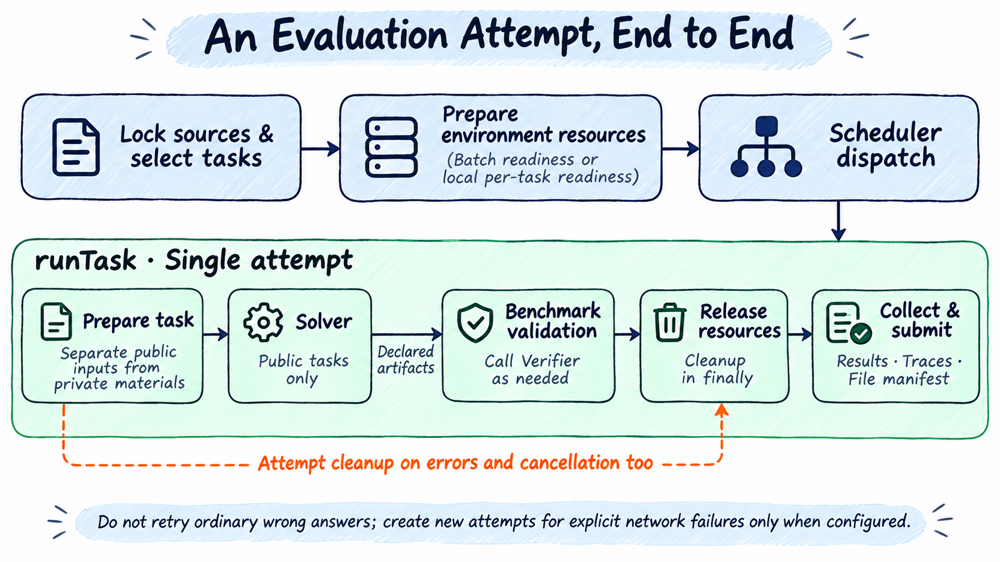
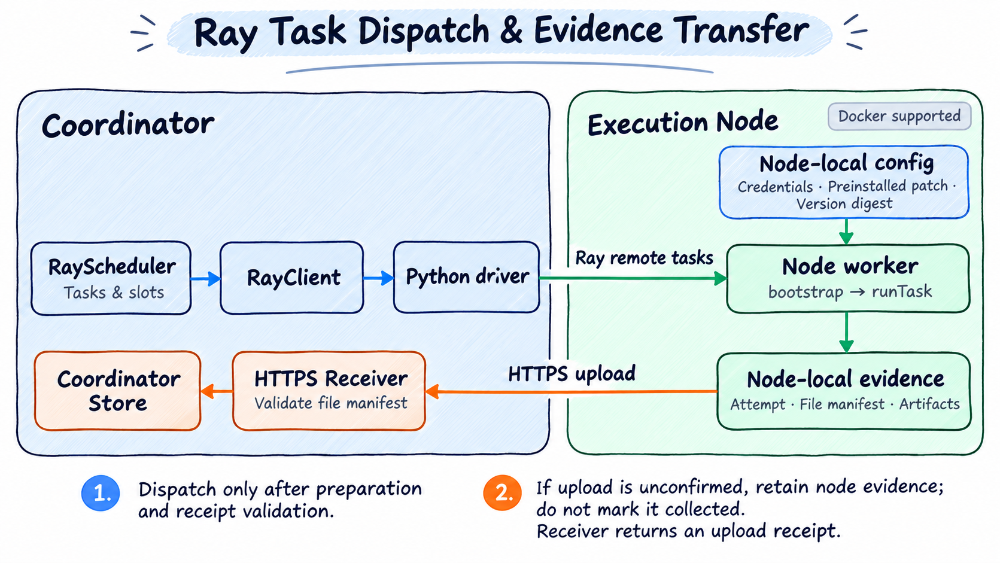

# Concurrency and Environment Preparation

> English | [中文](./concurrency.zh-CN.md)

Local execution defaults to a pipeline: tasks start solving as soon as their environments and execution slots are ready. Preparation concurrency defaults to `scheduler.concurrency`; `run.preparation` is optional. Ray retains a batch preparation barrier. This guide explains task concurrency, preparation budgets, execution, and cleanup. Start with [two questions](quick-start.md).



Resource release here means final attempt cleanup; separate verification also releases solve environments at phase transitions. Trajectories/artifacts may be written during execution; final manifests/results commit after cleanup. Failures and cancellation also retain available evidence where possible.

## Task Limits and Rolling Dispatch

`scheduler.concurrency: 20` (full form `scheduler.config.concurrency: 20`) allows up to 20 unfinished tasks. Once one finishes verification, cleanup, and persistence, another starts without waiting for the other 19. Tasks waiting on models still occupy slots.

Local checks `run.onError` before returning failures to the scheduler. Default is `continue`. Explicit abort stops replenishment; `continue` allows ordinary task failures. Lost prepared images are infrastructure errors and stop current dispatch even with continue.

## Preparation and Explicit Batch Mode

Built-in Harbor, DeepSWE, WorkBuddy, and Hugging Face benchmarks plan selected tasks, then prepare solve/verify resources and Solver runtimes: image pulls/builds, runtime checks, dependency installation, and readiness checks. Local starts each ready task; explicit `run.preparation.mode: batch` or Ray waits for all environments. Docker preparation creates no task containers. Task startup uses confirmed image identities with automatic pull disabled; unavailable images require a new preparation round.

HumanEval Python and `harbor-python` helper images count toward preparation budgets, avoiding model calls before failed verification setup. Local pipelines and Ray wait for these dependencies. Helper containers are created per attempt and cleaned on success, failure, and cancellation. `result.json` `environments.verificationRuntime` stores image/container identities. Unconfirmed deletion records cleanup failure and stops dispatch while retaining valid scores.

Each task's solve and verify environments are timed separately: base limit × min(effective preparation concurrency, 10). Queueing and ready-slot waits are excluded; no round limit applies by default. Harbor uses each environment's `build_timeout_sec`, then `defaults.buildTimeoutSeconds` (generic Harbor 600 seconds, DeepSWE 1800). Record benchmarks default to 600; OfficeQA Pro V2 and AgentX use 3600. See [preparation timeouts](config.md#environment-preparation-timeouts) for overrides/round caps.

Batch waits for the round; pipelines dispatch by readiness. Individual preparation failures save infrastructure errors without scores. `run.onError: continue` allows other successful tasks; `abort` stops them. Cancellation, unconfirmed cleanup, storage, or other stop-dispatch faults still terminate work.

Effective concurrency is fixed after round allocation: Local takes the smaller of configured concurrency and pending count; Ray also caps by node slots, not cluster-wide slots. Tail tasks retain established deadlines. With base 600 seconds, concurrency 1/4/32 gives 600/2400/6000 seconds per environment. This extends allowed time, not preparation speed. Execution concurrency and solve/score limits remain independent.

Both local modes use `run.preparation.concurrency`, defaulting to `scheduler.concurrency`; if execution concurrency is also omitted, both default to 1. Profiles with explicit concurrency (such as AgentX serial preparation) keep their declared values. Ray allocates by node slots; the field caps per-node preparation, otherwise using Scheduler limits/discovered slots. Shared Docker runtime, images, and verifier dependencies count toward their environment budgets. `manifest.json` `preparationRounds` saves policy, optional round cap, per-task/environment base, concurrency, multiplier, effective limit, and timestamps; Ray also saves `nodeConcurrency`. Resume creates a new round and retains history. Duration/report metrics read offline; missing historical environment budgets remain unknown rather than inferred from batch budgets.

Resume requires matching configuration, sources, code, and plugins. Start a new run after changing preparation modes or upgrading runtime packages. Historical results support offline reports.

Network retries occur within requests/downloads/pulls and are bounded. Exhaustion records failure without a new attempt. See [operation retries and manual recovery](network-retry.md) for explicit commands during/after runs.

### Timeouts and Scores

For quality benchmarks, agent phase deadlines or `run.timeoutSeconds` exhausted during solving yield `executionStatus: agent_timeout`, `scoreStatus: valid`. This is a valid zero included in the denominator, with no automatic rerun or `run.onError: abort`. After cleanup/persistence, dispatch continues. Resume skips these tasks. Without verification, `verdict` remains null; report zero comes from timeout policy.

AgentX timeout is an incomplete measurement, without accuracy or zero score. Ordinary deadlines are ineligible for network retries.

Recoverable model transport timeouts retry the individual request in the same SDK session. Budget exhaustion ends the attempt without restarting solving. Verification/framework budget exhaustion also does not automatically rerun. Invalid tasks retain unscored reasons; a valid zero removes historical network errors from the latest report. Task phase limits apply unless explicitly overridden by YAML. Wrong answers are not retried.

```yaml
run:
  onError: continue
```

Unconfirmed cleanup or remote process exit stops dispatch, retaining evidence and preventing overlapping manual reruns.

Local Scheduler selects batch/pipeline through `run.preparation.mode`, without automatic capacity/task-count switching. Local omitted preparation/mode means `pipeline`, with execution concurrency used for preparation. Ray omitted `mode` means `batch`. AgentX disallows `pipeline` and explicitly uses serial `batch` preparation. Batch may prepare concurrently but starts execution only afterward. Both modes/Ray call the same task steps: Solver runtime, solve environment, verification environment, verifier dependencies. Manual retries also reschedule preparation.

## Local Parallel Batch Preparation

```yaml
scheduler:
  name: local
  config:
    concurrency: 4       # Execution concurrency
run:
  preparation:
    mode: batch          # Explicitly select local batch mode
    concurrency: 2       # Preparation concurrency; omitted means execution concurrency, 4 here
```

This example prepares up to two tasks, then executes up to four, without overlap. batch does not use `lookahead`. Per-environment budgets scale by effective concurrency up to 10; explicit round caps do not scale. Cancellation/stop faults halt further preparation and wait for active work to exit.

## Local Readiness Pipeline

Set execution concurrency alone to overlap preparation/execution with equal limits. `scheduler: { name: local, concurrency: 4 }` prepares up to four tasks and executes up to four. To cap preparation or the ready queue separately:

```yaml
scheduler:
  name: local
  config:
    concurrency: 4
run:
  preparation:
    mode: pipeline
    concurrency: 2
    lookahead: 6
  onError: continue
```

Here preparation is limited to two and execution to four. Tasks enter readiness only after both solve/verify environments are prepared, then take free slots immediately. `lookahead` caps preparing plus ready-but-unexecuted tasks, defaults to `max(10, preparation.concurrency)`, and cannot be smaller than preparation concurrency. Full execution queues pause new preparation to avoid unlimited image backlog. Benchmarks still determine budgets; concurrency does not extend deadlines. Queueing/preparation do not consume task execution budgets.

Explicit network preparation failures may receive bounded recovery; other failures return directly. Failed prepared tasks retain diagnostics and become `invalid`; untouched tasks remain pending. `onError: abort` stops preparation/dispatch and cancels active work. Default `continue` runs others; preparation timeout permits ready/running tasks to finish but final run remains error. Network retries create new rounds/full attempts. Mode/concurrency changes require a new run. Same-configuration resume prepares only unfinished/invalid tasks and skips agent timeouts.

`preparationRounds.tasks` records queueing, environment preparation, separate solve/verify durations, and Docker task-image/runtime/Solver durations and cache sources. Attempt `readiness` records waits for execution slots. Reports/duration metrics read offline; absent historical fields remain unknown. Preparation/execution overlap, so their times cannot simply be added as wall-clock duration.

memory means completed in-process cache; shared means coalesced active preparation; image means existing image; built means new build; reference means explicitly supplied image. These are not BuildKit layer hit rates. Shared Solver installs are reused while tasks keep independent workspaces/containers. Ray rejects explicit pipeline and retains batch protocols.

Docker image names include short task names, solve/verify purpose, and kind. Shared installs use `ember-evaluator/shared`. Batch, pipeline, and Ray share naming, but caches belong to each node's Docker daemon. See [Docker FAQ](faq/docker.md#identify-and-inspect-task-images) for inspection, reuse, and upgrades.

Local batch/pipeline emit `[prepare]` by default without `EVALUATOR_DEBUG`. Task image readiness prints index, ID, purpose, elapsed time, and source, e.g. `Task 1/50 task=workbuddy/xxx Task image build completed; purpose=solve; elapsed 120.0s; source=new build`. Reused/explicit images say `Task image ready`, without claiming rebuilds. Runtime/Solver work may remain; pipeline `Environment ready` means full task readiness. Ray returns preparation/execution activity too. See [live previews](usage.md#live-execution-previews) for interactive multi-task display.

## Solve and Verification Resource Lifetimes

Before export, Docker sessions stop the entire container process space, then start only a fixed Evaluator idle entry for controlled exports. Quiesced sessions reject task processes/writes. Verification containers start only after confirmed solve cleanup; cleanup failure prevents verification.

Docker `cpus` caps container use rather than reserving cores. Waiting on models does not release process memory. Ordinary local environments stop tracked processes only, without Docker process namespace isolation.

### Docker Cleanup Timeouts

Cleanup has a separate budget; increasing `run.timeoutSeconds` does not extend it. `cleanupStatus: unconfirmed` stops dispatch while retaining valid scores; resume first recovers cleanup. See [Docker FAQ](faq/docker.md#do-cleanup-or-collection-failures-mean-wrong-answers).

## Ray Node Preparation and Execution



The upper path dispatches work; the lower returns evidence. The receiver verifies manifests, imports into coordinator Store, and returns receipts. Node completion alone does not confirm collection.

Preparation runs on execution nodes; the coordinator needs no Docker. Nodes independently verify locked sources and plugin/package versions, saving receipts. Attempts dispatch only after batch READY. `preparationRounds.placements` records nodes/receipt digests. Execution must match the full receipt on that node; missing/mismatched receipts stop dispatch without rebuilding. Failed preparation never runs agents; coordinator saves invalid diagnostics without scores.

Before preparation, Scheduler chooses the smallest allocated-task/node-slot ratio, breaking ties by node ID. Each task is assigned once; only its node pulls/builds task, verification, and sidecar dependencies. Tasks are not broadcast to all nodes. Progress shows counts per node. Preparation control sends model metadata without API keys; execution gets credentials through authenticated control channels.

Independent warmup uses the same placement/preparation code for direct Ray Client and Ray Jobs:

```bash
ember warmup ray-experiment.yaml
ember run ray-experiment.yaml
```

Warmup starts neither Solver nor scoring; `placements` lists task nodes. Identical selection order, nodes, and slots yield identical allocation. Node/capacity changes recompute it, and new nodes prepare their own images. Warmup does not replace run receipt checks or add cache copying, failover, or Ray pipelines.

Each task currently has one fixed preparation node. Preparation-node reassignment and balancing among ready nodes are unimplemented. Failure terminates the batch; resume prepares again. Coordinator/workers must deploy matching packages/plugins.

## Capacity and Limitations

`concurrency` is a user task cap, not an automatic safe limit based on CPU/memory. Docker limits do not reserve host resources. Check peaks with small samples before increasing concurrency.

Ray binds tasks to prepared nodes without moving failed preparation elsewhere. `scheduler.nodes` selects deployed nodes only; insufficient capacity for requested concurrency fails. See [Ray configuration](config.md#ray-and-execution-nodes).

[User documentation](README.md) · [Quick start](quick-start.md)
