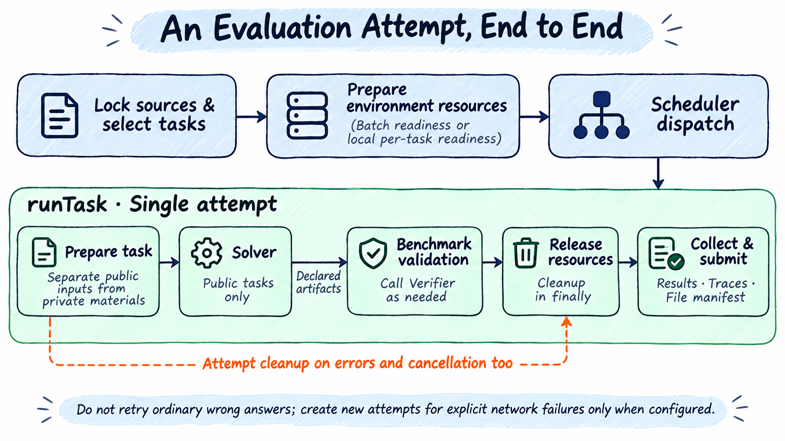
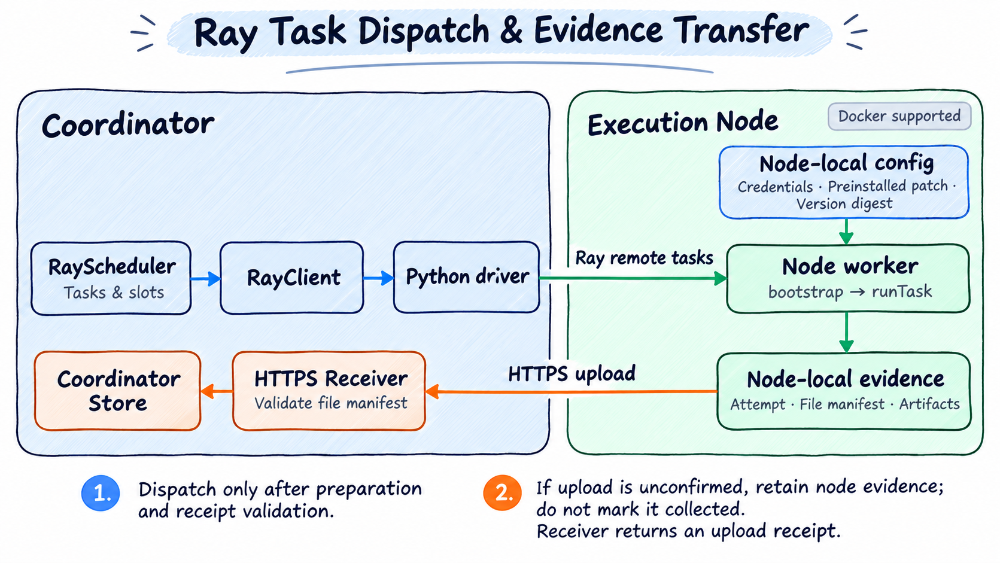

# 并发与环境准备

> [English](./concurrency.md) | 中文

本地默认使用流水线，环境就绪的题目在有空闲执行位置时立即开始解题；准备并发默认等于 `scheduler.concurrency`，无需额外填写 `run.preparation`。Ray 仍使用整批准备屏障。本文说明任务并发、准备预算、执行与清理的关系。第一次使用请先看[两题快速上手](quick-start.zh-CN.md)。



图中的“释放资源”表示单次 attempt 的最终清理；分离验证还会在阶段切换时提前回收求解环境。轨迹和产物可能在执行中写出，最终文件清单和结果在清理后提交。失败和取消也会尝试保留可收集的证据。

## 任务数量与滚动补位

`scheduler.concurrency: 20`（完整写法为 `scheduler.config.concurrency: 20`） 表示最多 20 个未完成任务。任意一个完成验证、清理和持久化后即可补入下一题，不需要等待其余 19 个结束。等待模型的任务仍占一个数量槽位。

本地执行在失败结果返回调度器之前判断 `run.onError`。`run.onError` 默认 `continue`。显式设置 abort 时不再补位；`continue` 允许普通任务失败后继续。准备镜像丢失属于基础设施错误，即使设置 `continue` 也停止本轮派发。

## 环境准备与显式整批模式

内置 Harbor、DeepSWE、WorkBuddy 和 Hugging Face Benchmark 先规划所选任务，再准备求解和验证所需的环境资源，以及 Solver 运行时。准备环境资源包括拉取或构建镜像、检查运行时、安装依赖并确认资源可用。本地默认每题环境就绪后即可启动 attempt；显式设置 `run.preparation.mode: batch` 或使用 Ray 时，全部环境就绪后才启动 attempt。Docker 在准备环境资源时不创建任务容器；任务启动使用已确认的镜像身份，禁止自动 pull。镜像不可用时需要重新开始准备轮次。

HumanEval 的 Python 验证镜像和 `harbor-python` 的辅助验证镜像也计入准备预算，准备失败时不会先调用模型再尝试验证。本地流水线和 Ray 节点同样等待这些依赖就绪。验证辅助容器在每次 attempt 中创建，成功、失败和取消均进入框架清理；其镜像和容器身份保存在 `result.json` 的 `environments.verificationRuntime`。未确认删除容器会记录清理错误，并阻止继续派发；已有有效评分仍保留。

环境准备按每题的求解环境、验证环境分别计时，时限为“基础时限 × min(有效准备并发数, 10)”。队列等待和就绪后等待执行不计入；默认没有整轮准备上限。Harbor 分别使用两个环境的 `build_timeout_sec`，缺省取 `defaults.buildTimeoutSeconds`（通用 Harbor 为 600 秒，DeepSWE Profile 为 1800 秒）；记录型题库缺省基础值为 600 秒，OfficeQA Pro V2 和 AgentX 为 3600 秒。配置覆盖和整轮上限见[环境准备时限](config.zh-CN.md#环境准备时限)。

整批模式等待本轮准备完成后派发，流水线按就绪顺序派发。单题准备失败保存基础设施错误，不产生评分；`run.onError: continue` 时继续准备并执行其他成功题目，`abort` 时停止。用户取消、资源清理未确认、存储或其他要求停止派发的故障仍终止工作。

有效准备并发在本轮分配完成后固定：Local 取配置准备并发和待准备任务数的较小值，Ray 再受该节点槽位数限制，不使用集群总槽位。尾部任务不缩短已经确定的时限。基础值 600 秒时，1、4、32 并发分别允许每个环境准备 600、2400、6000 秒；该规则放宽等待时间，不保证准备速度。执行并发与解题、评分时限保持各自配置。

本地两种模式的准备并发都由 `run.preparation.concurrency` 控制，省略时使用 `scheduler.concurrency`；执行并发也未设置时，二者默认均为 1；Profile 显式声明的并发（例如 AgentX 的串行准备）仍采用该声明值。Ray 按节点槽位容量分配任务，该字段限制每节点准备并发，缺省采用 Scheduler 上限或已发现槽位。Docker 的共享运行时安装、任务镜像和验证器依赖都计入对应环境的准备时限。`manifest.json` 的 `preparationRounds` 保存准备政策、可选整轮上限、每题每环境的基础时限、有效并发、倍率、实际时限和时间记录；Ray 另记 `nodeConcurrency`。续跑创建新轮次，重新计算时限并保留历史。duration 指标与报告支持离线读取；历史记录没有单环境预算时显示未知，不根据整批预算推算。

续跑要求配置、来源、代码和插件版本匹配。更换准备模式或升级运行包后，应新建 run；历史结果可离线报告。

网络访问只在对应请求、下载或拉取操作内有限重试。重试耗尽后记录失败，不自动创建新 Attempt。运行中和结束后的显式手动命令见[网络操作重试与手动补测](network-retry.zh-CN.md)。

### 超时与评分

质量型 Benchmark 的 Agent 达到解题阶段时限，或在解题时耗尽 `run.timeoutSeconds`，记录为 `executionStatus: agent_timeout`、`scoreStatus: valid`。这是有效评测，计入分母、记 0 分，不自动重跑，也不触发 `run.onError: abort`；清理和保存完成后即可补位。`--resume` 跳过此类任务。未运行 verifier 时 `verdict` 保持 null，报告中的 0 分由超时评测政策给出。

性能型 AgentX 超时属于未完成测量，不产生正确率或零分；普通时限耗尽不能通过网络补测重做。

模型请求传输超时等可恢复网络失败由模型 SDK 在同一会话内重试单次请求；预算耗尽后结束当前 Attempt，不从头求解。普通验证或框架阶段预算耗尽也不会自动补测。无效题保留未评分原因；得到有效零分后清除该题最新报告中的历史网络错误。阶段时限默认采用任务声明，只有显式 YAML 阶段配置才覆盖它；正常答错不补测。

```yaml
run:
  onError: continue
```

资源清理或远程进程退出未确认时会停止派发，保留证据，不启动可能重叠的手动重跑。

整批和流水线由本地 Scheduler 按 `run.preparation.mode` 选择，不会按任务数或资源自动切换。本地省略整个 `preparation` 或其中的 `mode` 时使用 `pipeline`，省略准备并发时使用执行并发；Ray 省略模式时使用 `batch`。AgentX 不支持流水线，其 Profile 明确设置串行整批准备。整批模式允许多个任务并行准备，但全部准备结束后才执行。两种模式及 Ray 节点调用相同的单题准备步骤，依次准备 Solver runtime、求解环境、验证环境和验证器依赖；显式手动补测也由 Scheduler 重新安排准备。

## 本地整批并行准备

```yaml
scheduler:
  name: local
  config:
    concurrency: 4       # 执行并发
run:
  preparation:
    mode: batch          # 本地整批模式需显式指定
    concurrency: 2       # 准备并发；省略时与本例执行并发一致，为 4
```

本例最多同时准备 2 题，整批准备结束后最多同时执行 4 题，两个阶段不重叠。batch 不使用 `lookahead`。单环境准备时限随有效准备并发放宽，倍率最多 10；显式整轮上限不乘并发。取消或要求停止的故障会停止后续准备，并等待已开始的准备退出。

## 本地环境就绪流水线

本地只需配置执行并发，准备并发就会使用相同值，并默认将准备与执行重叠。例如 `scheduler: { name: local, concurrency: 4 }` 最多同时准备 4 题、执行 4 题。需要单独限制准备并发或就绪队列时，可配置：

```yaml
scheduler:
  name: local
  config:
    concurrency: 4
run:
  preparation:
    mode: pipeline
    concurrency: 2
    lookahead: 6
  onError: continue
```

这里最多同时准备 2 题、执行 4 题。每题求解及验证环境都准备完成后即进入就绪队列，空闲执行槽位立即取出该题。`lookahead` 限制还未执行的准备中及就绪任务总数，默认 `max(10, preparation.concurrency)`，且不能小于准备并发；执行队列满时暂停新的准备，不无限积压镜像。准备预算仍由 Benchmark 决定，并发不会延长截止时间；排队与准备不占单题执行预算。

流水线下，明确网络准备失败可以有限补测；其他准备失败直接报错。已尝试准备但失败的题目保留诊断并记为 `invalid`，未开始准备的题仍为 pending。显式设置 `onError: abort` 会停止准备和派发并取消活跃任务；默认 `continue` 继续其余题，准备超时时允许已就绪及正在执行的题目完成，最终 run 仍标记 error。网络补测重新创建准备轮次和完整 Attempt。修改准备模式或并发后不能续跑旧配置的 run，须新开 run；相同配置续跑只重新准备未完成或无效题，跳过 Agent 解题超时。

`manifest.json` 的 `preparationRounds.tasks` 记录每题准备排队、环境准备、求解／验证环境的耗时，以及 Docker 的任务镜像、Runtime 和 Solver 准备耗时、缓存来源。attempt 的 `readiness` 记录就绪后等待执行槽位的时间。duration 指标与 Markdown 报告支持离线读取；历史结果没有这些字段时保持未知。准备与执行的耗时有重叠，不能直接相加作为总墙钟。

memory 表示同进程已完成缓存，shared 表示合并同进程正在准备的请求，image 表示已有镜像，built 表示新构建，reference 表示直接指定镜像引用；这些指标不表示 BuildKit 层缓存命中率。共享 Solver 安装继续复用，各题仍创建独立工作区及容器。流水线不支持 Ray，显式请求时会报错；Ray 保留原整批协议。

Docker 镜像名称包含任务短名、解题／验证用途和镜像种类；共享安装镜像放在 `ember-evaluator/shared` 下。整批、流水线和 Ray 使用相同命名规则，但缓存仍属于实际执行节点的 Docker daemon。查看命令、重复运行复用条件及旧版升级行为见 [Docker FAQ](faq/docker.zh-CN.md#如何按任务区分和查看镜像)。

本地整批及流水线模式默认输出 `[prepare]` 进度，不需要设置 `EVALUATOR_DEBUG`。Docker 任务镜像就绪后立即显示任务序号、ID、解题／验证用途、镜像准备耗时及缓存来源，例如 `Task 1/50 task=workbuddy/xxx Task image build completed; purpose=solve; elapsed 120.0s; source=new build`。缓存复用和直接指定镜像显示 `Task image ready`，不误报为重新构建。此时仍可能继续准备 Runtime 和 Solver；流水线的 `Environment ready` 表示整题环境已准备完成。Ray 节点也会回传环境准备和执行活动；交互终端的多任务显示规则见[实时执行预览](usage.zh-CN.md#实时执行预览)。

## 求解与验证的资源生命周期

内置 Docker session 在导出前停止整个容器进程空间，再仅启动 Evaluator 的固定空闲入口供受控导出使用。静止后拒绝新的任务进程和写入请求。确认求解容器回收之后才创建验证容器；回收失败不进入验证。

Docker 的 `cpus` 是单容器使用上限，不是预留核心。等待模型不会自动释放进程内存。普通 local 进程环境只停止自己跟踪的进程，不提供 Docker 的进程命名空间隔离。

### Docker 清理超时

清理使用独立预算，增加 `run.timeoutSeconds` 不会延长它。`cleanupStatus: unconfirmed` 时停止派发，已得到的合法评分仍保留；续跑先恢复清理。具体检查方法见[Docker FAQ](faq/docker.zh-CN.md#清理超时或证据收集失败是否表示模型答错)。

## Ray 节点准备与执行



上半部分是派发方向，下半部分是证据回传方向。接收端校验文件清单后导入协调端 Store，并返回上传回执；节点执行结束不等于协调端已确认收集。

准备发生在执行节点，协调端不需要 Docker。节点独立验证锁定来源和插件／包版本，保存准备回执，协调端在整批 READY 后才派发 attempt。`preparationRounds.placements` 记录每题的准备节点和回执摘要；执行必须在该节点匹配完整回执。缺失或不匹配时停止派发，不自动重建。准备失败不执行 Agent；协调端保存 invalid 诊断记录，没有任务评分。

在准备开始前，Scheduler 按“已分配题数 / 节点槽位数”选择下一个节点，相同时按节点 ID 排序。每题只分配一个节点，该节点只拉取、构建该题及其验证/侧车依赖，不向全部节点广播全部任务。进度会显示每个节点分到的题数。准备控制消息只传模型元数据，不传模型 API key；正式执行仍通过认证控制通道取得所需模型凭据。

独立预热使用相同分配和准备代码，支持直接 Ray Client 与 Ray Jobs：

```bash
ember warmup ray-experiment.yaml
ember run ray-experiment.yaml
```

预热不启动 Solver 或评分；摘要的 `placements` 列出每题所属节点。相同选题顺序、节点集合和槽位配置得到相同分配；节点或容量发生变化后重新计算，新节点准备自己的任务镜像。预热不替代正式运行的准备回执检查，也不增加跨节点缓存复制、故障迁移或 Ray 流水线。

当前每题固定一个准备节点。准备阶段节点故障重分配，以及在已就绪候选节点之间再平衡，尚未实现；失败时整批终止，续跑重新准备。部署时 coordinator 和所有 worker 必须使用匹配的运行包与插件版本。

## 容量与使用限制

`concurrency` 是用户设置的任务数量上限，不会根据实际 CPU、内存压力自动计算安全容量。Docker 的资源上限也不是宿主机资源预留。先以小样本检查峰值，再增加并发。

Ray 任务绑定已经准备的节点，不自动将准备失败的任务换到其他节点。`scheduler.nodes` 只选择已部署节点，容量不足目标并发时会报错。连接与配置见[Ray 与执行节点](config.zh-CN.md#ray-与执行节点)。

[返回用户文档](README.zh-CN.md) · [快速上手](quick-start.zh-CN.md)
