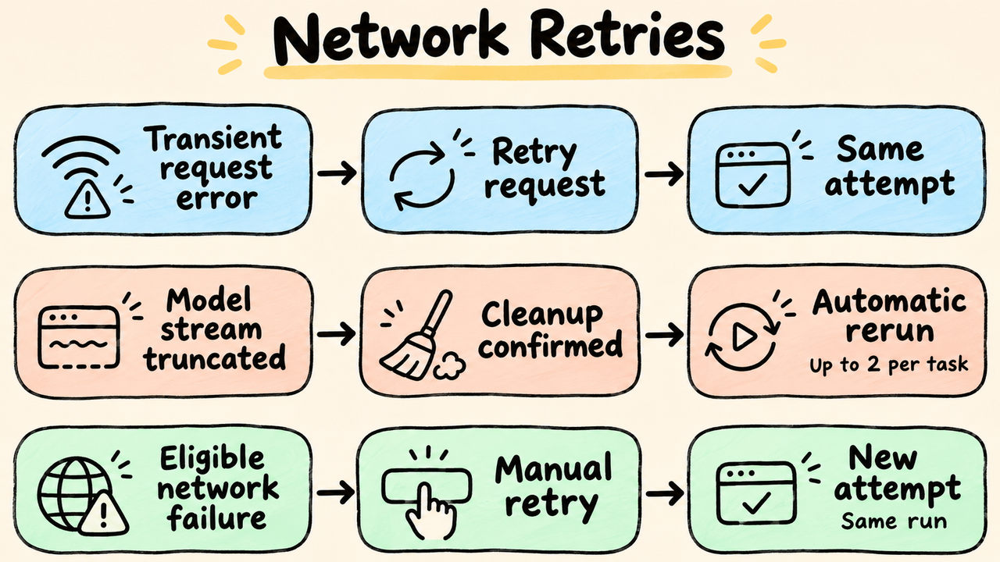

# Network Operation Retries and Manual Recovery

> English | [中文](./network-retry.zh-CN.md)

`ember-evaluator retry` creates full new attempts for invalid tasks with explicit network failures in the original run. It preserves task set, sources, model, Solver, official limits, and scoring. Zeros, wrong answers, valid agent timeouts, and failures without network evidence are ineligible.



## Automatic Network Retries

Network operations have their own request-level retries:

| Operation | Retry location |
| --- | --- |
| Model calls | SDK/adapter retries current request in the same session without replaying completed tools |
| APT downloads | APT retries failed downloads, up to three retries by default |
| Data file downloads | Downloader retries current file, retaining completed files |
| Metadata/registry requests | Retry request/response reads without re-preparing sources or downloading whole images |
| Docker pulls | Bounded retries reuse downloaded content |
| Artifact transfers | Retry requests under the original upload ID without solving/verifying/collecting again |

Framework network operations default to three attempts including the first. Model retry support and configuration depend on the Harness; `services.<name>.retry.maxAttempts` only affects adapters that consume it. Cancellation or the current phase deadline stops further request-level retries.

Evaluator also provides whole-task recovery for explicit model response truncation. When a Harness reports a solve failure containing evidence such as `Response payload is not completed`, insufficient transfer length, or `incomplete chunked read`, Evaluator saves the failed attempt, confirms cleanup, and creates a new attempt. Each task permits at most two automatic reruns. Resume counts saved truncation failures toward this budget instead of resetting it. After exhaustion, `run.onError` controls whether other tasks continue; the failed task remains unscored.

Each new attempt starts with a fresh workspace and a full task deadline. Earlier model requests and tools run again, adding time and cost; external tool side effects are not undone. Normal model output remains streamed without buffering the entire SSE response or patching the Harness. This fallback cannot detect truncation that the Harness swallows as success or reports without specific truncation evidence.

A bare `APIConnectionError`, ordinary SSE error, HTTP 400, authentication or quota failure, valid zero, cancellation, or collection/cleanup failure does not trigger this automatic recovery. Model request timeouts are also outside this rule. Image builds use `ENV_IMAGE_BUILD_FAILED` and do not automatically rerun the task. Third-party plugins and task scripts control their own retries.

Remove `run.taskRetry` from old YAML. Configure model request limits as above and recover failed tasks manually with the commands below. See [resume requirements](usage.md#resume-and-rebuild-reports).

## Commands

```bash
ember-evaluator retry --run <run-id>
ember-evaluator retry --run <run-directory> --task-id terminal-bench/example --request-id network-fix-1 --reason "registry network restored"
```

Repeat `--task-id` to select multiple tasks, or omit it to select all eligible network failures. With no eligible tasks, the command returns normally without starting new attempts. When recovering an ended evaluation, add `--network network.yaml` to change download sources or proxies. A running evaluation keeps its startup network settings.

Select the original evaluation by Run ID or result directory. The ID index defaults to `~/.ember/runs/`, configurable with `EVALUATOR_RUN_INDEX_DIR`. After copying results to another machine, pass the directory directly. Ray Jobs still needs the original gateway and its authentication to operate on the remote run; a downloaded result copy cannot replace it.

While the evaluation is running, the command submits recovery to the original process and other tasks continue. After it ends, recovery continues in the same run. `retry` selects eligible network failures; `--resume` handles unfinished tasks according to resume rules.

Requests during data or environment preparation may show `pending` until scheduling is ready. `accepted` means the request was accepted; `rejected` requires following the reported cause.

For an unconfirmed request, resend the original `requestId` from the error with `--request-id` to avoid duplicate submissions. If the original process is exiting, wait for it to exit, then resend the same ID.

Before recovery, restore model and service authentication variables referenced by the original configuration in the command's launch environment. Saved results do not contain recoverable keys. If original credentials used literal values without variable references, follow the error to supply the required configuration. See [resume requirements](usage.md#resume-and-rebuild-reports) for configuration, source, and plugin rules.

## Manual Recovery and Execution Location

Each manual request adds one attempt per eligible task. If that attempt reports explicit model truncation and the task still has automatic recovery budget, the fallback above also applies. Resending the same `requestId` does not create duplicates; tasks already preparing or running are not queued again.

Recovery is blocked while a task is still running or resource release is unconfirmed, to prevent overlapping execution. Local and Ray support recovery; Ray Jobs still operates through the original gateway and writes new results into the original run.

## Eligible Failures

The error must be `NETWORK_FAILURE` with an explicit network cause. Evaluator also checks for an existing valid score and released resources; not every timeout or failure is eligible.

| Operation | Eligible evidence | Ineligible evidence |
| --- | --- | --- |
| Docker Pull | DNS, disconnects, transfer timeouts, temporary 5xx | Missing images, authentication, incompatible platforms |
| Runtime installation | Explicit download diagnostics outside image builds | Image build failure, dependency conflict, ordinary deadline |
| Model API | APIConnectionError, read timeout, temporary 5xx, recoverable throttling | Exhausted quota, refusal, invalid parameters, context/output limits, agent deadline |
| Data sources | Explicit GitHub/HF/HTTP connection/download failures | Version, format, digest, permanent authentication errors |
| Verifier | No reward and explicit dependency-download network failure | Official zero, verifier logic error, ordinary total verification timeout |

Image build download failures retain `ENV_IMAGE_BUILD_FAILED` and trigger neither automatic nor manual task retries. APT retries downloads inside its command; exhaustion fails the build without replaying the attempt.

Network errors inside model tools do not qualify a task that ultimately completes with a score. Unresolved collection/storage/cleanup errors also block reruns despite other network evidence.

## Latest Results and History

Each task uses one valid result, never the highest score. If an initial pull fails and recovery receives official zero, the latest report shows normal completion/zero and omits the old network error. Once all tasks have valid results and no unresolved cleanup/run faults remain, run status changes from `error` to completed.

- `tasks/.../attempts/` retains original failures, trajectories, logs, and new attempts.
- `manifest.json` retains initialization failures and preparation history.
- `retry` updates root reports and, after prior resume, the report referenced by `reports/current.json`, without a new directory.
- Explicit resume creates `reports/resume-N/`, preserving initial reports under `reports/initial/` and previous resume reports. If report generation was interrupted, rebuild it with the command below.

```bash
ember-evaluator report <run-directory>
```

The latest report counts current results and unresolved run failures. Historical failures remain in attempt directories. `attempt-accounting` totals known tokens, time, and cost across attempts; missing usage is marked separately, so known costs are not a complete bill.

A Run ID is retained even when the first data download fails. Task counts remain undetermined until recovery succeeds and the actual task set is available.
