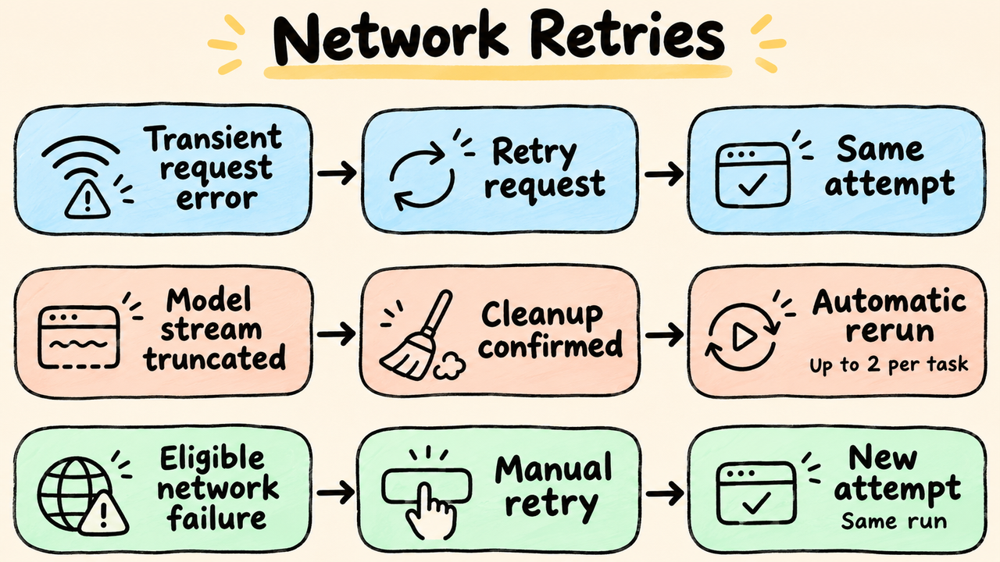

# 网络操作重试与手动补测

> [English](./network-retry.md) | 中文

`arsi-evaluator retry` 为原工作流中失败或中断的样例创建新的完整 attempt，不改变题目、来源、模型、步骤或评分规则。已保存的有效评分（包括合法零分）继续复用。网络故障是常见用途，手动补测不限于网络错误。



## 自动网络重试

网络操作自身的重试发生在对应操作内：

| 操作 | 重试位置 |
| --- | --- |
| 模型调用 | 模型 SDK 或适配器重试当前请求，保留当前会话，不重放已完成的工具 |
| APT 下载 | APT 自身重试失败的下载项，缺省最多重试 3 次 |
| 数据文件下载 | 下载器重试当前文件，保留已完成文件 |
| 元数据、registry 请求 | 重试当前请求及响应读取，不重新准备整个来源或下载整个镜像 |
| Docker 拉取 | 在拉取操作内有限重试，复用 Docker 已下载的内容 |
| 产物传输 | 按原上传标识重试对应请求，不重新解题、验证或收集 |

框架网络操作默认最多尝试 3 次（含首次）。模型调用是否支持重试、如何配置，由具体 Harness 决定；`services.<名称>.retry.maxAttempts` 只对读取该配置的适配器生效。取消操作或到达当前阶段的时限后，不再继续请求级重试。

Evaluator 另提供模型断流的任务级兜底：Harness 返回失败，且求解错误包含明确的响应体截断证据（如 `Response payload is not completed`、传输长度不足、`incomplete chunked read`）时，在失败 Attempt 保存且资源清理确认后，创建新 Attempt 从头解题。每题最多自动重跑 2 次；续跑从已保存的截断失败记录计算剩余次数，不重置预算。仍失败时按 `run.onError` 结束或继续其他题，评分保持无效。

新 Attempt 使用新的工作区和完整任务时限，之前的模型请求与工具操作都会重新执行，耗时和费用也会增加；外部系统中的工具副作用不会自动撤销。正常模型输出仍实时传输，Evaluator 不缓存整段 SSE，也不修改 Harness 的重试实现。Harness 吞掉断流并返回成功，或只返回没有截断证据的泛化错误时，此兜底无法触发。

单独的 `APIConnectionError`、普通 SSE error、HTTP 400、鉴权或额度错误、有效零分、用户取消，以及收集/清理失败都不会触发该自动重跑。模型请求超时也不属于这条截断规则。镜像构建失败使用 `ENV_IMAGE_BUILD_FAILED`，不自动重跑整题。第三方插件和任务脚本自己的重试由它们各自控制。

旧 YAML 中的 `run.taskRetry` 需要删除。模型请求次数改用上述配置，失败任务按下方命令手动补测。恢复条件见[续跑说明](usage.zh-CN.md#续跑与重建报告)。

## 命令

```bash
arsi-evaluator retry --run <run-id>
arsi-evaluator retry --run <run-directory> --task-id terminal-bench/example --request-id network-fix-1 --reason "registry network restored"
```

重复传入 `--task-id` 可选择多道题；省略时选择失败或中断的工作流样例。已完成且证据有效的样例不会重复执行。补测使用保存的网络模板，不接受 `--network` 更换模板；可修复模板引用的环境变量或节点网络后重试，例如更新 `HF_ENDPOINT`。正在运行的进程继续使用已打开的客户端。

可用 Run ID 或结果目录指定原评测。ID 索引默认保存在 `~/.arsi-evaluator/runs/`，可用 `EVALUATOR_RUN_INDEX_DIR` 修改。跨主机复制结果后，请直接传结果目录。Ray Jobs 需要通过原网关操作远端 run，并保留原网关认证；下载到本机的结果副本不能直接代替远端 run。

原评测仍在运行时，命令向原进程提交补测请求，其他题目继续执行；原评测已结束时，会在同一个 run 中恢复。`retry` 可指定失败样例并保留请求 ID；`--resume` 按整个工作流的恢复规则处理未完成任务。

准备数据或环境期间，请求可能显示 `pending`，调度就绪后处理；`accepted` 表示已受理，`rejected` 表示未受理，应按返回原因处理。

如果提示请求未确认，使用错误信息中的原 `requestId`，通过 `--request-id` 重发，避免重复提交。原进程正在结束时，等它退出后再使用同一个 ID 重发。

补测前，在启动命令的环境中恢复原配置引用的模型和服务认证变量。结果文件不保存可直接恢复的密钥；原认证只使用字面值、没有环境变量引用时，需要按报错补齐配置。配置、来源和插件等恢复要求见[续跑说明](usage.zh-CN.md#续跑与重建报告)。

## 手动补测与执行位置

每次手动请求为符合条件的任务增加一次执行。如果这次执行发生明确模型断流，且该题仍有自动重跑预算，也会使用上述兜底。同一个 `requestId` 重发不会重复创建执行；已经准备或运行中的题目也不会重复排队。

原任务仍在运行时不会重复派发；资源释放未确认时，必须先完成恢复清理才能重新执行。Local 和 Ray 均支持补测；Ray Jobs 仍通过原网关操作，并将新结果写回原 run。

## 哪些失败可以补测

手动补测选择失败或中断的工作流样例，并校验保存计划、业务输入和清理状态。下表用于判断 Benchmark 网络问题的修复方向，不是手动补测仅允许 NETWORK_FAILURE 的限制；有效业务评分不会因为分数低而重跑。

| 操作 | 通常可通过恢复网络修复 | 需要检查配置或业务行为 |
| --- | --- | --- |
| Docker Pull | DNS、连接中断、传输超时、临时 5xx | 镜像不存在、鉴权、平台不兼容 |
| Runtime 安装 | 非镜像构建操作中的明确下载网络诊断 | 镜像构建失败、依赖冲突、普通阶段截止时间 |
| Model API | APIConnectionError、请求读取超时、临时 5xx、可恢复限流 | 额度耗尽、拒答、非法参数、上下文/输出上限、Agent 总时限 |
| 数据来源 | GitHub/HF/HTTP 的明确连接或下载故障 | 版本、格式、摘要及永久鉴权错误 |
| Verifier | 没有产生奖励，失败操作输出明确依赖下载网络错误 | 官方测试得零分、验证逻辑错误、普通验证总超时 |

镜像构建下载失败保留 `ENV_IMAGE_BUILD_FAILED`，不会触发整题自动重试；修复后可手动补测失败样例。APT 在当前命令内按下载配置重试；耗尽后本次构建失败，不重新执行整个 Attempt。

模型工具调用里曾出现网络错误，但 Agent 最终正常完成并得到评分，不会因此补测。存在未解决的收集、存储或清理错误时，也不会仅凭另一条网络证据启动补测。

## 最新结果与历史

每题只使用一个合法有效结果，不选最高分。如果首次 Docker Pull 失败、补测得到官方零分，最新报告显示该题正常完成、评分 0，原网络错误不再进入失败列表和错误统计。如果所有题目都有有效结果，且没有未解决的清理或运行级故障，工作流从 `failed` 恢复为 `completed`。

- `benchmark-evidence/<run-id>/tasks/.../attempts/` 保留原始失败、轨迹、日志和新 Attempt。
- `benchmark-evidence/<run-id>/manifest.json` 保留 Benchmark 初始化失败与准备轮次历史；根目录 `run.json` 记录工作流状态。
- `retry` 更新根目录报告；若之前执行过 `--resume`，同时更新 `reports/current.json` 指向的续跑报告，不新增目录。
- 显式 `--resume` 另建 `reports/resume-N/`；首次续跑前的报告保存在 `reports/initial/`，此前的续跑报告保留。报告生成中断时，可用下方命令重新生成。

```bash
arsi-evaluator report <run-directory>
```

最新报告只统计当前结果和仍未解决的运行故障，历史失败仍可在各次执行目录查看。`attempt-accounting` 累计所有执行中已知的 Token、耗时和费用；缺失用量会单独标记，不能把已知费用当作完整账单。

数据首次下载失败时，仍会保留 Run ID，但题目数暂时显示为未确定；恢复成功后才会显示实际题目范围。
