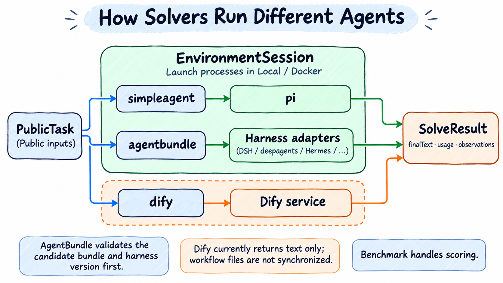

# Choosing Solvers and Model Services

> English | [中文](./solvers.zh-CN.md)

Benchmarks define tasks and scoring; solvers define model requests and agent execution. Start ordinary agent tasks with default SimpleAgent. MMLU and AgentX have dedicated defaults. Check configuration and start a new run after changes.

## Choose a Solver

| Solver | Purpose | Prerequisites |
| --- | --- | --- |
| `simpleagent` | Built-in Pi Agent for quality tasks and tool/file operations | Model API with tool calling; optional Pi Bundle |
| `agentbundle` | Packaged DSH, deepagents, Hermes, Jiuwenswarm, or pi agents | Readable, valid bundle and harness requirements |
| `dify` | Call a Dify application or install one from a bundle | Dify address and Service API key; currently primarily returns text |
| `agentx-replay` | Trace-driven model requests for service performance | Streaming API, long context, tokenizer, and Python or Docker |
| `choice-logprobs` | Candidate probabilities at one output position for MMLU | local environment; actual logprobs/top_logprobs support; disable thinking when needed |

`simpleagent` is the framework default. AgentX profiles select `agentx-replay`; MMLU profiles select `choice-logprobs`. MMLU cannot be scored solely from an agent's final letter. See [scoring](reference/scoring.md#mmlu-probability-scoring-and-service-requirements) for service requirements, missing candidates, and Chat adaptation differences.



Select one solving path per configuration. EnvironmentSession represents execution interfaces and process boundaries; it does not move all solver plugin code into containers. Harness adapters read output and construct `SolveResult`. Benchmarks still score tasks. See [AgentX](benchmarks/agentx.md) for performance replay.

## Model Services and Independent Judges

This complete two-task example declares both the evaluated model and a judge:

```yaml
services:
  default:
    model: ${MODEL_NAME}
    base_url: ${MODEL_ENDPOINT}
    api_key: ${MODEL_API_KEY}
  judge:
    model: ${JUDGE_NAME}
    base_url: ${JUDGE_ENDPOINT}
    api_key: ${JUDGE_API_KEY}
benchmark:
  name: simpleqa
  config:
    judgeService: judge
environment: local
run:
  maxTasks: 2
output:
  directory: ./results/simpleqa
```

Set all six environment variables as shown in [quick start](quick-start.md#3-set-model-variables), then `run` `doctor` and `run`. Replace `simpleqa` with `healthbench` to use its profile.

- `benchmark.solver.service` selects the solving service. If omitted, it prefers `services.default`, otherwise the sole service. Multiple non-default services require explicit selection.
- **SimpleQA/HealthBench** select judges through `benchmark.config.judgeService`; the evaluated model is not automatically used as judge. `init` generates judge variables. Use `judgeService: default` to reuse the default service explicitly.
- **Harbor/WorkBuddy** model verifiers use `benchmark.verifier.service`. Web requires a judge; Office model scoring is optional. See [Harbor](benchmarks/harbor.md). This differs from record-based benchmarks' `judgeService` field.

`api` defaults to `openai-completions`. With an explicit Chat Completions `base_url`, Pi/SimpleAgent and built-in judges send no client output cap unless `services.<name>.maxTokens` is a positive integer. Other providers and external harnesses retain their protocol-specific rules.

Add `maxTokens: 8192` to a service to limit replies. Configure model request retries with `services.<name>.retry.maxAttempts`; exhaustion ends the current attempt without restarting the solution.

## SimpleAgent and Pi Bundles

The default needs only `benchmark: gsm8k`. To use your Pi Bundle, apply this fragment while keeping services, environment, and other fields:

```yaml
benchmark:
  name: gsm8k
  solver:
    name: simpleagent
    config:
      bundle:
        path: ${PI_BUNDLE_PATH}
```

Point to a prepared Pi Bundle, rather than an arbitrary source directory. `bundle.settings` supplies serializable Pi settings applied to a staged copy, leaving the original bundle intact.

Tool commands have separate timeouts. Increasing the task budget does not make shell commands unlimited. To adjust them:

```yaml
benchmark:
  name: gsm8k
  solver:
    config:
      toolPolicy:
        shellTimeoutSeconds: 180
        shellMaxTimeoutSeconds: 600
```

Provide both fields; the maximum must be at least the default. This fragment retains default `simpleagent`. Actual tool call timeouts cannot exceed the maximum.

## AgentBundle

Follow [source installation](installation.md#install-from-source) to prepare Evaluator. pnpm installs the AgentBundle SDK automatically, without a sibling source repository. `AGENT_BUNDLE_PATH` below points to a prepared **agent bundle directory**, supplied separately rather than the SDK installation path.

```yaml
services:
  default:
    model: ${MODEL_NAME}
    base_url: ${MODEL_ENDPOINT}
    api_key: ${MODEL_API_KEY}
benchmark:
  name: gsm8k
  solver:
    name: agentbundle
    config:
      path: ${AGENT_BUNDLE_PATH}
environment: local
run:
  maxTasks: 2
  timeoutSeconds: 900
output:
  directory: ./results/gsm8k-agentbundle
```

Prefer an absolute `AGENT_BUNDLE_PATH`. Evaluator reads the declared harness and checks content identity and version ranges before selecting an adapter; directory names are not used to guess. Start a new run after bundle changes.

| Harness declaration | Behavior |
| --- | --- |
| `dsh` | Prepare and run through DSH; see [DSH output](usage.md#dsh-tool-output) |
| `deepagents` | `deepagents` / LangGraph adapter |
| `hermes` | Hermes adapter |
| `jiuwenswarm` | Jiuwenswarm adapter |
| `pi` | pi with release artifact and settings digest validation |

Some harnesses require preinstalled local runtimes or dependency installation during Docker preparation. Local directories do not automatically become container/remote paths. Check bundle and harness deployment requirements before choosing a [Playbook](../../playbook/README.md) environment.

Specify existing installations with Solver settings such as `dshhome`, `dshprofile`, `hermeshome`, or `jiuwenswarmhome`. `jiuwenswarmTimeoutSeconds` applies only to that harness. Additional pi settings use `benchmark.solver.config.pi.settings`, unsupported by other harnesses.

Prefer `services.<name>.maxTokens` for output limits. AgentBundle also accepts Solver `maxTokens`, but setting both is an error. Bundle creation belongs to the relevant AgentBundle project; this repository validates and executes existing bundles.

## Dify

For a published application accepting the task input, use this text-task example:

```yaml
services:
  default:
    model: dify-app
    base_url: ${DIFY_BASE_URL}
    api_key: ${DIFY_SERVICE_API_KEY}
benchmark:
  name: gsm8k
  solver:
    name: dify
    config:
      baseUrl: ${DIFY_BASE_URL}
      apiKeyEnv: DIFY_SERVICE_API_KEY
environment: local
run:
  maxTasks: 2
  timeoutSeconds: 900
output:
  directory: ./results/gsm8k-dify
```

Set `DIFY_BASE_URL` to the service address, such as `https://dify.example`, without `/v1` or `/workflows/run`; the adapter appends `/v1/workflows/run`. The published Workflow must accept text input `task` and return text `report` or `answer`; other output objects are saved as JSON text. `apiKeyEnv` is a variable name, not a key value.

services retains required framework metadata. The Dify application solves the task; Evaluator does not send model requests using `dify-app`.

For a Dify Bundle, set `bundlePath` and optional `registryPath`. The SDK validates, installs, and obtains its Service API key. Use `appId` to specify application identity.

**The Dify Solver currently does not sync workflow-generated files back to task environments.** Its existence does not establish support for Office or repository-editing tasks requiring files. Prefer SimpleAgent or AgentBundle, which can write through EnvironmentSession. The [Office Dify YAML](../../playbook/workbuddy/workbuddy-office-dify.yaml) illustrates configuration and documents this limitation.

## AgentX Service Performance

No AgentBundle preparation is needed. `benchmark.name: agentx` selects a dedicated trace-request solver. The API must support streaming, `ignore_eos`, full context, and required output lengths.

- `replay`: explicitly set `traceCount` and complete a finite trace set, suitable for adaptation acceptance.
- `standard`: fixed `standard` measurement windows and load rules.

vLLM `/metrics` and Ascend sampling endpoints are optional; without them only model API performance is measured. `replay` is not a formally comparable score; standard must pass upstream and local validity checks. See [AgentX](benchmarks/agentx.md) for parameters, Python requirements, and NPU collection.

[User guide](README.md) · [Daily operations](usage.md) · [Configuration reference](config.md)
