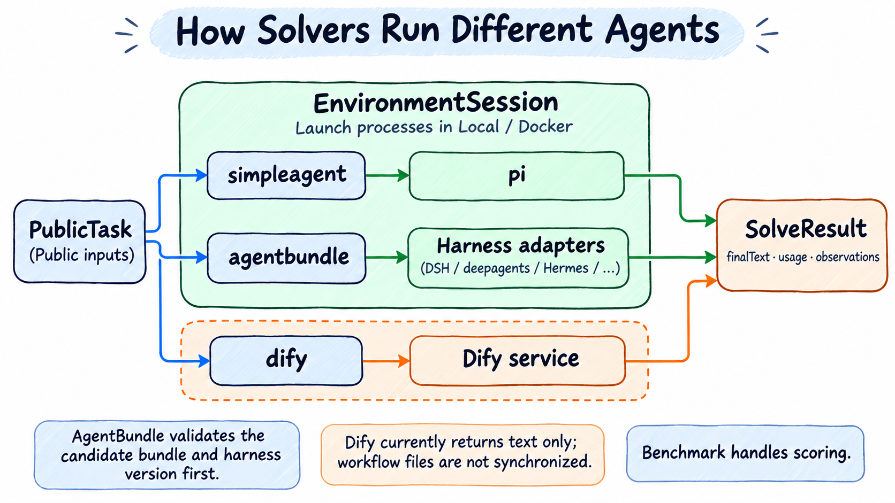

# 选择 Solver 和模型服务

> [English](./solvers.md) | 中文

Benchmark 决定任务和评分，Solver 决定模型请求或 Agent 怎样执行。普通 Agent 任务可先用默认 SimpleAgent 跑通；MMLU 和 AgentX 使用各自的默认 Solver。修改后先做配置检查，并开始新的 run。

## 选哪一种 Solver

| Solver | 用途 | 额外准备 |
| --- | --- | --- |
| `simpleagent` | 内置 Pi Agent，普通质量题与需要工具/文件操作的任务 | 支持工具调用的模型 API；可选 Pi Bundle |
| `agentbundle` | 运行已打包的 DSH、deepagents、Hermes、Jiuwenswarm 或 pi Agent | 可读取且格式正确的 Bundle，满足对应 Harness 运行条件 |
| `dify` | 调用 Dify 应用，或从 Bundle 安装 Dify 应用 | Dify 地址和 Service API key；当前主要返回文本 |
| `agentx-replay` | 按 Trace 请求模型，测量服务性能 | AgentX 所需的流式 API、长上下文、tokenizer 和 Python 或 Docker |
| `choice-logprobs` | 直接请求单个输出位置的候选概率，供 MMLU 评分 | local 环境；模型服务必须实际返回 logprobs/top_logprobs；按需关闭思考 |

`simpleagent` 是框架通用默认值。AgentX Profile 自动选择 `agentx-replay`；MMLU Profile 自动选择 `choice-logprobs`。MMLU 不能仅靠 Agent 最后输出的字母评分，服务要求、候选缺失处理及 Chat 适配差异见[评分规则](reference/scoring.zh-CN.md#mmlu-概率评分与服务要求)。



每次选择一条求解路径。图中的 EnvironmentSession 表示运行接口和进程执行边界，不表示 Solver 插件代码被整体移动进容器；Harness 适配器负责读取输出并构造 `SolveResult`。评分仍由 Benchmark 执行，AgentX 的性能回放见[专项指南](benchmarks/agentx.zh-CN.md)。

## 模型服务与独立裁判

这是同时声明被测模型和 Judge 的完整两题示例：

```yaml
services:
  default:
    model: ${MODEL_NAME}
    base_url: ${MODEL_ENDPOINT}
    api_key: ${MODEL_API_KEY}
  judge:
    model: ${JUDGE_NAME}
    base_url: ${JUDGE_ENDPOINT}
    api_key: ${JUDGE_API_KEY}
benchmark:
  name: simpleqa
  config:
    judgeService: judge
environment: local
run:
  maxTasks: 2
output:
  directory: ./results/simpleqa
```

按[快速上手](quick-start.zh-CN.md#3-设置模型变量)的方式设置六个环境变量，然后运行 `doctor` 和 `run`。把 `simpleqa` 换成 `healthbench` 即使用 HealthBench 的 Profile。

- `benchmark.solver.service` 选择求解服务；省略时优先用 `services.default`，否则使用唯一服务。多个非 default 服务必须明确选择。
- **SimpleQA/HealthBench** 用 `benchmark.config.judgeService` 选择裁判，不会自动把被测模型当作裁判。`init` 会为它们生成 judge 服务变量；想显式复用同一个服务，可填 `judgeService: default`。
- **Harbor/WorkBuddy** 的模型验证器使用 `benchmark.verifier.service`。Web 要求裁判，Office 的模型评分可选，详见[Harbor 指南](benchmarks/harbor.zh-CN.md)。这与记录型 Benchmark 的 `judgeService` 不是同一个配置入口。

`api` 缺省为 `openai-completions`。显式 `base_url` 使用 Chat Completions 时，Pi/SimpleAgent 和内置 Judge 在未设置 `services.<名称>.maxTokens` 时不发送客户端输出上限；填写正整数时才发送。其他 Provider 和外部 Harness 保留各自协议的配置规则。

如需限制当前服务回复，可以在该服务条目增加 `maxTokens: 8192`。模型请求重试使用 `services.<名称>.retry.maxAttempts`，耗尽后结束当前 Attempt，不自动从头求解。

## SimpleAgent 与 Pi Bundle

默认写法只需要 `benchmark: gsm8k`。要让内置 Pi Agent 使用你的 Bundle，修改为以下片段；保留原 services、environment 等字段：

```yaml
benchmark:
  name: gsm8k
  solver:
    name: simpleagent
    config:
      bundle:
        path: ${PI_BUNDLE_PATH}
```

路径指向已准备好的 Pi Bundle，不是任意源码目录。可用 `bundle.settings` 提供可序列化的 Pi 设置，框架在暂存副本中使用，不直接改原 Bundle。

工具命令另有超时，增加任务总预算不会自动让单条 shell 命令无限执行。需要调整时：

```yaml
benchmark:
  name: gsm8k
  solver:
    config:
      toolPolicy:
        shellTimeoutSeconds: 180
        shellMaxTimeoutSeconds: 600
```

两项都要填写，最大值不能小于默认值；该片段保留默认的 `simpleagent`。工具调用时实际超时不超过最大值。

## 使用 AgentBundle

先按[源码安装](installation.zh-CN.md#直接安装)准备 Evaluator；pnpm 会自动安装 AgentBundle SDK，无需同级源码仓库。下面的 `AGENT_BUNDLE_PATH` 指向已制作好的 **Agent Bundle 目录**，需要另行准备，不是 SDK 安装路径。

```yaml
services:
  default:
    model: ${MODEL_NAME}
    base_url: ${MODEL_ENDPOINT}
    api_key: ${MODEL_API_KEY}
benchmark:
  name: gsm8k
  solver:
    name: agentbundle
    config:
      path: ${AGENT_BUNDLE_PATH}
environment: local
run:
  maxTasks: 2
  timeoutSeconds: 900
output:
  directory: ./results/gsm8k-agentbundle
```

`AGENT_BUNDLE_PATH` 建议使用绝对路径。Evaluator 会读取 Bundle 声明的 Harness，检查内容身份及版本范围，再选择适配器，不通过目录名猜测。Bundle 修改后应开始新 run。

| Harness 声明 | 对应使用方式 |
| --- | --- |
| `dsh` | 按 DSH 协议准备与运行，工具输出格式见[DSH 说明](usage.zh-CN.md#dsh-工具输出) |
| `deepagents` | 使用 deepagents / LangGraph 适配器 |
| `hermes` | 使用 Hermes 适配器 |
| `jiuwenswarm` | 使用 Jiuwenswarm 适配器 |
| `pi` | 使用 pi，检查发布产物与设置摘要 |

某些 Harness 需要本机预装运行时，或在 Docker 准备阶段安装依赖；本机目录不会自动变成容器/远端可用路径。先确认 Bundle 和 Harness 的部署条件，再按 [Playbook](../../playbook/README.md) 选对应环境。

已有安装位置可用 `dshhome`、`dshprofile`、`hermeshome`、`jiuwenswarmhome` 等 Solver 配置指定；`jiuwenswarmTimeoutSeconds` 只针对对应 Harness。pi 的额外设置放在 `benchmark.solver.config.pi.settings`，其他 Harness 不接受这个字段。

输出上限优先放在 `services.<名称>.maxTokens`。AgentBundle 也接受 Solver 的 `maxTokens`，但两处同时填写会报错，不要重复配置。如何制作各 Harness 的 Bundle 属于对应 AgentBundle 项目的范围，本仓库负责校验和执行已有 Bundle。

## 使用 Dify

对已经发布、能接收当前任务输入的 Dify 应用，可用下面的文本题示例：

```yaml
services:
  default:
    model: dify-app
    base_url: ${DIFY_BASE_URL}
    api_key: ${DIFY_SERVICE_API_KEY}
benchmark:
  name: gsm8k
  solver:
    name: dify
    config:
      baseUrl: ${DIFY_BASE_URL}
      apiKeyEnv: DIFY_SERVICE_API_KEY
environment: local
run:
  maxTasks: 2
  timeoutSeconds: 900
output:
  directory: ./results/gsm8k-dify
```

`DIFY_BASE_URL` 填 Dify 服务地址，例如 `https://dify.example`，不要带 `/v1` 或 `/workflows/run`；当前适配器会追加 `/v1/workflows/run`。应用需是已发布的 Workflow，接收名为 `task` 的文本输入，返回文本字段 `report` 或 `answer`；其他输出对象会作为 JSON 文本保存。`apiKeyEnv` 写环境变量名称，不写密钥值。

services 保留框架所需的服务元数据；实际求解由 Dify 应用执行，并非 Evaluator 用 `dify-app` 向模型服务发请求。

若使用 Dify Bundle，可另设 `bundlePath` 和可选的 `registryPath`，由 SDK 校验和安装，并取得应用的 Service API key。`appId` 可用于明确应用身份。

**当前 Dify Solver 没有把工作流生成的文件同步回任务环境。** 它不适合作为 Office、代码仓库修改等文件交付任务已经可用的证明；这些任务优先选择能写入 EnvironmentSession 的 SimpleAgent 或 AgentBundle。已有 [Office Dify YAML](../../playbook/workbuddy/workbuddy-office-dify.yaml) 是配置组合示例，文件中也标明了该限制。

## 用 AgentX 测服务性能

不需要先制作 AgentBundle。选择 `benchmark.name: agentx` 后，由专用 Solver 发送 Trace 请求；API 必须满足流式、`ignore_eos`、完整上下文与输出长度要求。

- `replay`：显式指定 `traceCount`，完整跑完有限 Trace，适合适配验收。
- `standard`：固定的标准测量窗口及负载规则。

vLLM `/metrics` 和 Ascend 采样端点是可选项，不配置时只测模型 API。`replay` 不能作为正式可比成绩，standard 也要通过上游和本地的有效性检查。完整参数、Python 条件及 NPU 采集方式见 [AgentX 指南](benchmarks/agentx.zh-CN.md)。

[返回用户手册](README.zh-CN.md) · [日常操作](usage.zh-CN.md) · [完整配置参考](config.zh-CN.md)
