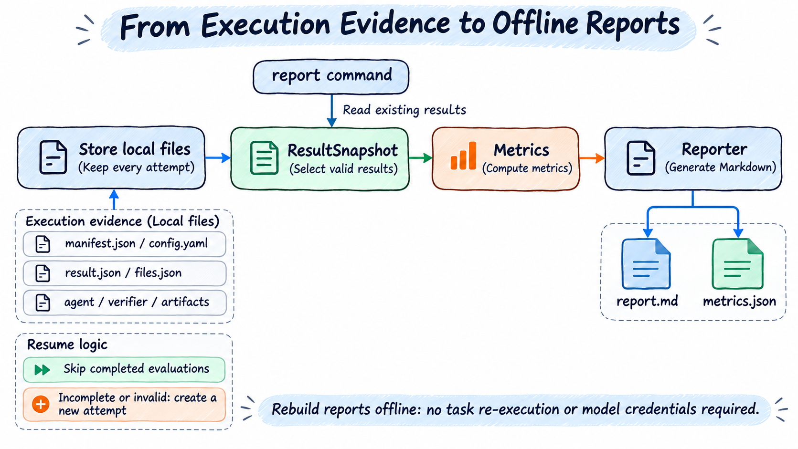

# Daily Operations

> English | [中文](./usage.zh-CN.md)

Start with the [two-question quick start](quick-start.md). This guide uses first-run.yaml. Merge fragments into existing fields; do not duplicate run:/benchmark: blocks.

## Task Selection and Concurrency

### Select a Small Sequential Sample

```yaml
run:
  maxTasks: 2
  timeoutSeconds: 300
```

Omitting `maxTasks` runs all selected tasks. Confirm counts/budgets before removing sample limits for large runs.

Add `run.offset` to start partway through; see [offset/count](config.md#task-offset-and-count).

### Deterministic Random Sampling

```yaml
run:
  maxTasks: 2
  sampling:
    strategy: random
    seed: 42
```

Identical source/seed repeats selection. After source changes, seed alone cannot preserve tasks; Evaluator also saves versions/digests.

### Preview and Save Actual Task IDs

```bash
ember-evaluator run first-run.yaml --dry-run > task-ids.json
```

dry-run locks sources, checks caches, downloads as needed, and enumerates without Solver execution. Output uses this JSON format; example GSM8K IDs differ from other benchmarks:

```json
{"taskIds":["test:0","test:1"]}
```

Select those IDs explicitly later:

```bash
ember-evaluator run first-run.yaml --task-ids-file task-ids.json
```

CLI ID files replace YAML IDs and clear offset/maxTasks/sampling. YAML `run.taskIds` still undergoes those later filters; omit all three to fix only the listed tasks.

### Warm Images Without Evaluation

Use independent `warmup` with production YAML:

```bash
ember-evaluator warmup first-run.yaml
# Use plain-text progress output:
ember-evaluator warmup first-run.yaml --progress plain
```

Selection follows taskIds/sampling/offset/maxTasks. It prepares solve/separate-verification/sidecar images, Evaluator runtimes, and Solver layers, using production pulls/builds/layer composition/network YAML/concurrency/budgets. Temporary build containers may install dependencies. Warmup calls no models, starts no solve/scoring sessions, and creates no evaluation results/metrics/reports.

Final output contains one ready/failed count line followed by each failed task's ID, error code, and reason. Successful task details and the full JSON are omitted. An entirely successful warmup prints only the count line; failures return exit code `1`.

For fixed IDs/external plugins:

```bash
ember-evaluator warmup first-run.yaml --task-ids-file task-ids.json --patch cordis.patch.yaml
ember-evaluator run first-run.yaml --task-ids-file task-ids.json --patch cordis.patch.yaml
```

task-ids-file overrides selection exactly as run. Matching configuration/task versions/platform/daemon reuse caches in later evaluations; repeated warmup checks/reuses them. Model keys are unnecessary, but model names/endpoints/bundle paths must be valid. Unlike dry-run's data download/enumeration, warmup accepts neither dry-run nor resume.

Local Docker, Ray Client, and Ray Jobs use the same command. Ray allocates by node slots before image work; each task/node prepares only assigned tasks/dependencies. Unassigned nodes get no request. Coordinator prepares no task images. Jobs returns progress/cancellation/summaries through authenticated TLS gateways.

Update gateway/coordinator/workers and plugins together. Old gateways lack warmup; mismatched nodes reject preparation.

Identical sources/order/nodes/slots produce matching warmup/run placements and reusable node caches. Runs still check fresh receipts and bind prepared nodes. Changes recompute placements; new nodes prepare as needed without cross-node cache moves. Shared bases/install layers may cache independently on multiple nodes. See [Ray preparation](concurrency.md#ray-node-preparation-and-execution).

External plugins require benchmark.planRun()/scheduler.prepareTasks(); local environments require materialize(), remote schedulers setupPreparation(). Progress uses stderr; stdout JSON lists `taskIds`, `readyTaskIds`, `failures`, `preparationRounds`, `placements` (empty locally). All ready exits0, `failures` nonzero, cancellation130. Jobs saves warmup control/summary only, without evaluation runs/scores/reports.

### Delete Evaluation Images

`cleanup images` previews by default; `--yes` deletes without interactive confirmation:

```bash
# Preview task images and dependencies prepared by this configuration
ember-evaluator cleanup images first-run.yaml
ember-evaluator cleanup images first-run.yaml --yes

# All recognized evaluation images in the current Docker daemon
ember-evaluator cleanup images --all
ember-evaluator cleanup images --all --yes

# Connect to Ray using YAML and clean evaluation images on all target nodes
ember-evaluator cleanup images first-run.yaml --all --yes
```

Supports local Docker/Ray Client/Jobs. Add --patch for external YAML plugins. Cleanup calls no models/downloads/tasks and does not start/rebuild clusters. Jobs still requires gateway authentication/TLS; update all deployment roles together.

Evaluation/warmup save records on Docker nodes. YAML cleanup matches Benchmark/Environment/Solver/Verifier/selection, excluding output/authentication/scheduling concurrency. Changed selection/images/installation leave records under old config; use original YAML or --all. Shared images remain until their last configuration association is removed.

Includes managed task bases/builds/runtime/Solver/final-agent/gateway/services. Recorded sources actually downloaded by Evaluator may be removed; preexisting references remain. `--all` handles historical ember-evaluator images; external history without download proof stays. Unrecorded third-party images are not guessed from YAML.

Skip images referenced by running/stopped containers, occupied by preparation/evaluation, or with uncertain occupancy. Recheck IDs before deleting selected references only; no force/prune. Ray nodes sharing one daemon must share EVALUATOR_CACHE_DIR/records to combine deletion; mismatched records conflict/skip.

stdout JSON lists candidate/deleted/retained/skipped/failed by node, each with reasons. Exit0 success,`1` delete/unreachable-node failure,`2` arguments,`130` cancellation. Repeated cleanup tolerates already-missing images.

Records default to `EVALUATOR_CACHE_DIR/docker-images`, otherwise system cache locally or node `outputRoot/cache/docker-images` for Ray. Persist this directory to retain source download provenance after node replacement.

This command leaves build caches, datasets, archives, results, and persistent Ray clusters. Removing references may free less disk than image size because layers remain shared.

### Increase Execution Concurrency

```yaml
scheduler:
  name: local
  concurrency: 2
```

This runs at most two tasks simultaneously without changing total count. Higher concurrency adds rate-limit/memory/CPU/preparation pressure. Start at1; see [concurrency](concurrency.md) for batch/pipelines/slots.

AgentX differs: `benchmark.config.concurrency` counts harness session trees; `scheduler.concurrency` stays1. `maxTasks` selects points, not trace requests.

## Budgets and Failure Handling

```yaml
run:
  timeoutSeconds: 900
  onError: continue
```

- `timeoutSeconds` is total per task. Harbor may also declare solve/verify/build limits; changing this alone does not override all upstream deadlines.
- `onError: continue` continues ordinary failures; `abort` stops. Authentication/quota/resource/unconfirmed-cleanup faults may still end runs.
- Networking retries bounded operations, not whole tasks. Configure model attempts via `services.<name>.retry.maxAttempts.` Removed `run.taskRetry` must be deleted from old YAML.

Wrong answers, ordinary timeouts, and preparation failures are not all retried. Do not overwrite historical attempts to improve scores. See [errors/recovery](reference/errors.md).

Preparation/cleanup budgets are separate from run.timeoutSeconds. `run.preparation` configures local pipelines; Ray pipelines are unsupported. See [preparation](concurrency.md).

## Inspect Configuration

```bash
ember-evaluator inspect first-run.yaml
```

`inspect` prints JSON with effective experiment and network settings, preserving credential references. Its output is for inspection, not a standalone experiment YAML. Result `config.yaml` remains an internal execution record.

The `run` command can override the Solver-bound model service:

```bash
ember-evaluator run first-run.yaml --model your-other-model --api-key-env OTHER_MODEL_API_KEY
```

Supports --model/--endpoint/--api-key-env or literal --api-key. Last two are mutually exclusive; prefer variables. Independent judges remain unchanged.

`warmup`, `doctor`, and `inspect` read model settings from YAML and do not accept these overrides. Edit the YAML or its referenced environment variables before checking or preparing a different configuration.

## Resume and Rebuild Reports

```bash
ember-evaluator run first-run.yaml --resume
ember-evaluator run first-run.yaml --resume <RUN_ID>
ember-evaluator report results/first-run/<RUN_ID>
```

Without ID, Evaluator finds resumable history; explicit IDs avoid mistakes. Keep sources/config/code/plugins matching. Model/selection/preparation/concurrency changes need new runs.

Resume recovers cleanup first, then creates attempts for unfinished/invalid tasks. Valid results, including valid agent-timeout zeros, skip solving. Failed AgentX points rerun wholly rather than continuing requests.

`report` performs no solving/model authentication. External `report` plugins must remain available/version-matched. Keep full directories; changed manifests/content fail. Do not edit `result.json` to repair scores.

Error classification/handling separates abnormal task and error-record counts and main/collection/cleanup failures. Multiple records can involve one task; row counts are not additive task totals. After solve timeout, complete required files with unfinished trajectories yield evidence warnings; missing/export-failed files remain collection errors. Historical rebuilds preserve original errors/scores, changing presentation only.

Tasks shows saved solve/verify actual seconds with two decimals. Solve includes pre-timeout execution, excluding preparation/verification/cleanup; performance displays measurement time. Missing/unexecuted phases show —. Error cells deduplicate codes per task; full text remains JSON. Evidence links point to results/manifests/recorded trajectories.

Markdown reports show overview, scores, durations, model usage, current task results, and errors. They omit costs, historical attempts, rounds, and metric-field reference text. Saved data computes metrics without model-generated analysis; missing usage/timing stays unknown. Full/raw cost data remains metrics.json/manifest/task/trajectory JSON.

New runs create new IDs with root report.md/metrics.json. Explicit resume retains IDs but writes `reports/resume-1/`,resume-2/; initial reports go to reports/initial/. Root always reflects latest, with `reports/current.json` pointing to current resume reports. Automatic retries during resume, standalone `retry`, and offline `report` update current reports without new directories. Existing revision-N history remains but no new revisions are created. Evidence links reference original task files.

## Read Results



`Store` saves files; `ResultSnapshot` selects effective task results; Metrics computes; Reporter renders; `saveReport` persists through Store. Offline `report` uses the same path without Solver.

Each run has a directory; attempts remain separate:

```text
results/first-run/<RUN_ID>/
├── report.md                 # Report to open first
├── metrics.json              # Computed metrics
├── manifest.json             # Status, selection, sources, and versions
├── config.yaml               # Internal execution configuration, without credential values
└── tasks/<task-directory>/attempts/<ATTEMPT_ID>/
    ├── result.json           # Attempt execution, scoring, and cleanup
    ├── files.json            # Evidence file manifest
    ├── agent/                # Sessions, trajectories, process output
    ├── verifier/             # Verification evidence
    └── artifacts/            # Collected raw artifacts, possibly archived
```

Task directories may be hashed. Locate through report links/result task IDs, not assumed original-ID directory names.

| Question | Location | Meaning |
| --- | --- | --- |
| Did the run finish? | Report/manifest status | `completed` means process completion, not all correct |
| Did a task execute? | Execution status/errors in `result.json` | Timeout/cancellation/invalid are distinct |
| What `score`? | verdict.score | Missing is not automatically0 |
| Was binary correctness measured? | verdict.passed | `null` means unmeasured, not error/False |
| Is scoring valid? | `scoreStatus` | Judge/infrastructure failure is not wrong answer |
| Were resources released? | `cleanupStatus` | `unconfirmed` needs recovery; valid scores may exist |
| Is evidence complete? | collection/files | Reports mark missing/partial evidence |

Quality correctness/continuous scores follow separate rules. AgentX has no quality scores; inspect replay coverage, request errors, actual windows, comparability, and source status. See [scoring](reference/scoring.md)/[AgentX](benchmarks/agentx.md).

Task summaries omit full questions/answers by default; set `run.includeTaskAnswer: true` beforehand if needed. Native sessions/trajectories/artifacts may still contain task contents; inspect before sharing.

SimpleAgent `usage` covers full-session calls, compaction, SDK-reported auxiliaries, cache reads/writes, not just retained final context. `usage` aggregates returned solve results; `attempt-accounting` also includes saved failed/timed-out/cancelled usage. Trajectory `usage` checkpoints are cumulative and must not be summed. Unreturned/unsaved `usage` stays unknown; client zero prices do not imply free provider service. Upgrades do not rewrite historical data; offline reports read saved records.

### DSH Tool Output

Large DSH results save full files plus preview events without new YAML. Small outputs remain session.jsonl/trajectory.jsonl; results>8 KiB or JSON>32 KiB go under attempt agent/tool-outputs/.

Events retain callId/status/result. Large results add:

- `truncated: true` means preview truncation, not failure; previews retain start/end.
- `resultRef` is the full file path relative to attempt root, e.g. `agent/tool-outputs/<unique-id>.txt`, with generated names independent of callId.
- `originalBytes` is pre-redaction UTF-8 size.
- `storedBytes` is actual file size.
- `sha256` is actual file digest, checked with size on receipt; missing/corrupt files fail explicitly.

Files/previews redact current model keys; digests cover redacted files. Full means tool text available before DSH export, not bypassing tool limits. Model context is unaffected.

`files.json` records paths/sizes/hashes through existing Local/Ray evidence transfer. Already-written outputs survive interruption where collectable. Upgrades cannot restore lost historical output.

This adapts pinned DSH 0.1.6-alpha.2 headless JSON exporters at process load without global changes. Other implementations may need adapters; do not guess call IDs/status to repair incomplete events.

## Local, Docker, and Ray

| Mode | Configuration | Use |
| --- | --- | --- |
| Current machine | `environment: local`, local scheduler | Record tasks, AgentX, debugging; no container isolation |
| Local Docker | `environment: docker`, local scheduler | Code/files/terminal/Harbor; Linux container engine |
| Managed local Ray | `scheduler.name: ray`, optional concurrency | Actual runs prepare local Ray Jobs |
| Current-process Ray coordination | `scheduler.name: ray` plus config.endpoint, no deployment | Existing clusters with collector/TLS/node setup |
| Whole-experiment Ray Jobs | `deployment.kind: ray-jobs` with Ray scheduler | Remote coordinator; submitter creates no solve components |

General default is Docker; profiles may override, e.g. AgentX local. Environment and scheduler are independent; local schedulers also dispatch Docker tasks.

Ray alone needs no deployment; configuration inspection starts no cluster. Existing remote Ray Jobs uses advanced configuration:

```yaml
deployment:
  kind: ray-jobs
  endpoint: https://your-head.example:9443
  caFile: ./cluster-ca.pem
  tokenEnv: EVALUATOR_JOBS_TOKEN
  managedLocal: false
scheduler:
  name: ray
  concurrency: 4
  nodes: 2
```

Prepare CA/variables/gateway/nodes, then run normal YAML commands. `nodes` selects existing capacity without scaling. Explicit deployment defaults managedLocal:false, while shorthand without deployment/Client endpoint selects managed local clusters. Jobs receipts support follow/cancel/download/resume. Do not substitute HTTPS scheduler endpoints for deployment.

See [Ray config](config.md#ray-and-execution-nodes), [cluster examples](../../playbook/README.md), [toolbox](deployment/container-toolbox.md), and [platforms](deployment/docker-platform.md).

## Load External Plugins

```bash
ember-evaluator doctor experiment.yaml --patch experiments/plugins/cordis.patch.yaml
ember-evaluator run experiment.yaml --patch experiments/plugins/cordis.patch.yaml
```

Replace paths with actual files. Omitted `--patch` scans nothing. Discovery/init/config/doctor/run must share the patch. Patch paths use current directory; modules use patch directory; business paths use YAML directory.

See [plugin loading](../development/plugins.en.md), [benchmark development](../development/benchmarks.en.md), and [requirements/acceptance](../development/benchmark-evaluation-requirements.en.md). Ray nodes need matching installed plugins/local patches; coordinator paths alone are insufficient.

## Common Issues and Exit Codes

| Symptom | First checks |
| --- | --- |
| Model401/403 | Key/endpoint/permissions; `doctor` does not call models to verify keys |
| GPQA/tokenizer401/403 | Approval/HF_TOKEN, separate from model keys; [authentication](config.md#gated-hugging-face-authentication) |
| Data download failure | HF_ENDPOINT/proxy/access; switch mirrors to official if needed |
| Long prepare | Identify pulls/builds/runtime installs, disk/network/budgets |
| Docker unavailable/architecture mismatch | Daemon/platform/emulation |
| Truncated model output | Actual stop reason; adjust explicit `maxTokens` or server limits |
| Resume source/version mismatch | Changed config/source/package/plugins; start new run if needed |
| `cleanupStatus: unconfirmed` | Recover resources before global cleanup around other evaluations |

Bash debug: EVALUATOR_DEBUG=1 ember-evaluator run first-run.yaml. PowerShell sets `$env:EVALUATOR_DEBUG="1"` first. Progress/errors use stderr; final paths stdout.

### Live Execution Previews

Framework terminal prompts/progress/warnings/actions use English. Task/tool/third-party raw output retains its language. Generated Markdown reports remain Chinese.

run/retry default `--progress auto`: interactive terminals show task steps/elapsed time/up to 10 recent lines. Panels use at most half terminal height and20 lines, prioritizing statuses; small windows/high concurrency reduce previews. Success clears previews/leaves completion; failure retains up to 5 redacted lines. plain disables panels; tty requests them but noninteractive/TERM=dumb uses logs. CI disables panels; `NO_COLOR` only disables colors.

```bash
ember-evaluator run first-run.yaml --progress auto
ember-evaluator retry --run <run-id> --progress plain
```

Docker uses actual pull/build output. Pi/DSH/DeepAgents show existing model activity/tools/output; Dify workflow/nodes; AgentX harness activity. Hermes/JiuwenSwarm lack live tool details and state this. Reply/reasoning bodies/private verification are excluded. Incomplete lines report activity before displaying complete text to avoid secret leakage across chunks.

Source preparation shows cache validation/bytes/repository/file counts; local scans/hashes; archives checks/extractions. Percentages require reliable uncompressed totals, otherwise bytes only. Planning shows task index/ID/file activity/failures; enumeration shows read/selected counts. Counts reflect actual processing, not image readiness or prepared totals.

After60 seconds without activity, prompts suggest inspection without cancellation/retry/deadline changes. UI refreshes/heartbeats/repeated snapshots are not activity. Unknown totals show no percentages. Status rows come first; excess tasks show hidden counts, expandable by resizing.

Local/direct Ray/Jobs share panels. Jobs needs cluster-reachable `EVALUATOR_JOBS_PROGRESS_ORIGIN` (default `https://gateway:9443`), matching CA/credentials, provided by bundled scripts. Refollow retrieves memory snapshots. Disconnection>10 seconds warns; heartbeat/collection/plain logs remain independent. Old gateways warn once and fall back.

Previews create no files/results/trajectories/Ray logs. Each step stores up to 10 lines,2 KiB each; remote per-run bodies cap2 MiB, dropping previews while retaining status. Gateways keep memory progress until60 seconds after completion; restarts recover from later snapshots. Inactive previews alone do not establish hangs.

| Exit code | Meaning |
| --- | --- |
|`0`|Completed, including wrong answers/protocol-handled agent timeouts|
|`1`|Runtime/system failure, or doctor check failure|
|`2`|Configuration/arguments|
|`130`|User cancellation|

See [error codes](reference/errors.md) for full recovery/retry rules. `ember-evaluator --help` lists current arguments.

[User guide](README.md) · [Quick start](quick-start.md) · [Configuration](config.md)

## Discover Benchmarks

`ember-evaluator benchmark list` displays a table of names, versions (equivalent definitions grouped in parentheses), default versions, scenarios, default scenarios, and implementations. Plugins without version metadata show `undeclared`. Metadata comes from registered plugins and profiles; listing does not check dataset or image availability.

```bash
ember-evaluator benchmark list
ember-evaluator benchmark list --json
ember-evaluator benchmark info terminalbench
ember-evaluator benchmark list --patch ./patch.yaml
```

`list --json` preserves all version names and alias groups. `info` prints JSON including resolved settings per version. External plugins require an explicit `--patch`. Running `benchmark` without a subcommand shows group help.
