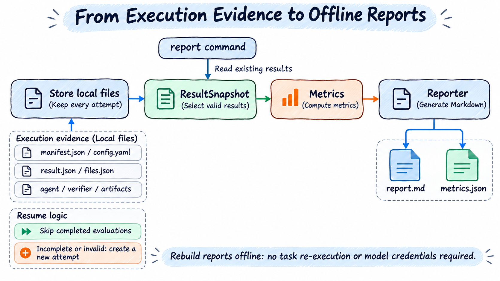

# 日常操作

> [English](./usage.md) | 中文

第一次使用先完成[两题快速上手](quick-start.zh-CN.md)。本文使用同一份 `first-run.yaml`；YAML 示例是修改片段，需要合并到已有同名字段中，不要重复写两个 `run:` 或 `benchmark:`。

## 选择题目与并发

### 按顺序取少量题

```yaml
run:
  maxTasks: 2
  timeoutSeconds: 300
```

省略 `maxTasks` 会运行所有选中任务。不要直接把两题样例的限制删掉后就开始大规模运行，先确认题量和预算。

需要从中间某题开始运行时，增加 `run.offset`，用法见[指定起始题目与题数](config.zh-CN.md#指定起始题目与题数)。

### 固定随机抽样

```yaml
run:
  maxTasks: 2
  sampling:
    strategy: random
    seed: 42
```

相同来源和 seed 得到可重复的选题。来源更新后，不能仅靠 seed 保证还是同一批题；Evaluator 会另外保存来源版本和摘要。

### 查看并保存实际任务 ID

```bash
ember-evaluator run first-run.yaml --dry-run > task-ids.json
```

`--dry-run` 会锁定来源、检查缓存、按需下载和枚举题目，不执行 Solver 解题。输出格式为下面的 JSON；GSM8K 的示例 ID 如下，其他 Benchmark 使用自己的 ID：

```json
{"taskIds":["test:0","test:1"]}
```

以后可明确指定这批 ID：

```bash
ember-evaluator run first-run.yaml --task-ids-file task-ids.json
```

CLI 文件会替换配置里的选题 ID，并清除原 `offset`、`maxTasks` 和随机抽样限制。也可在 YAML 写 `run.taskIds`；它仍受同一 YAML 中 `sampling`、`offset` 和 `maxTasks` 的后续处理，因此只想固定这些题时请省略这三个参数。

### 只预热镜像，不开始测评

使用独立的 `warmup` 命令，传入正式评测使用的 YAML：

```bash
ember-evaluator warmup first-run.yaml
# 使用纯文本进度输出：
ember-evaluator warmup first-run.yaml --progress plain
```

命令按 YAML 的 `taskIds`、`sampling`、`offset` 和 `maxTasks` 选择题目，准备解题镜像、独立验证镜像、侧车镜像，以及 Evaluator 运行时和 Solver 安装层。镜像下载、Dockerfile 构建、镜像层拼接和 网络 YAML 使用与正式运行相同的逻辑，准备并发和预算也沿用 YAML。构建需要的临时容器可以执行安装命令；预热不调用模型、不启动解题或评分会话，不创建评测结果目录、指标或报告。

命令结束时只输出一行就绪/失败数量，以及各失败任务的 ID、错误码和原因，不再打印成功任务明细和完整 JSON。全部成功时只输出统计行；存在失败时退出码为 `1`。

需要固定题目或加载外部插件时，可以使用：

```bash
ember-evaluator warmup first-run.yaml --task-ids-file task-ids.json --patch cordis.patch.yaml
ember-evaluator run first-run.yaml --task-ids-file task-ids.json --patch cordis.patch.yaml
```

`--task-ids-file` 覆盖 YAML 选题的规则与 `run` 相同。预热完成后，使用相同配置、任务版本、平台和 Docker daemon 运行评测，即可复用本机缓存；再次预热会检查并复用已有缓存。预热不要求模型 API key；YAML 引用的模型名称、端点、Bundle 路径等配置仍需有效。它与只下载数据、枚举 ID 的 `run --dry-run` 是两个独立操作，不接受 `--dry-run` 或 `--resume`。

本机 Docker、直接 Ray Client 和 Ray Jobs 均可使用同一命令。Ray 在拉取或构建任务镜像前，按执行节点槽位容量分配题目；每题只分配一个节点，该节点只准备自己的题目及其依赖镜像。没有分到题目的节点不会收到准备请求。预热不会在协调机准备任务镜像；Ray Jobs 的进度、取消和准备摘要通过现有网关返回，仍需集群认证和 TLS 配置。

部署更新时，gateway、coordinator 和所有 worker 需要一起更新运行包及预装插件；旧网关不支持预热操作，版本不匹配的节点不能接收准备任务。

同一来源、选题顺序、节点集合和槽位配置下，预热与正式评测得到相同分配，可复用各节点镜像缓存。正式评测仍检查本次准备回执，并固定在准备节点执行。节点或容量改变时重新分配，新的执行节点按需准备；镜像缓存不会自动跨节点搬运。公共基础镜像及 Solver 安装层可在需要它们的多个节点分别缓存。详见 [Ray 节点准备与执行](concurrency.zh-CN.md#ray-节点准备与执行)。

外部插件需要实现 `benchmark.planRun()`、`scheduler.prepareTasks()`；本机环境需要 `environment.materialize()`，远端 Scheduler 还需要 `setupPreparation()`。进度写入 stderr，stdout 输出 JSON 摘要：`taskIds` 为选中任务，`readyTaskIds` 为就绪任务，`failures` 为失败项，`preparationRounds` 为本次准备记录，`placements` 列出 Ray 任务所属节点（本机为空数组）。全部就绪返回 `0`，准备失败返回非零，用户取消返回 `130`。Ray Jobs 只保存预热作业的控制信息和摘要，不创建评测 Run、评分或报告。

### 删除评测镜像

`cleanup images` 默认只预览；添加 `--yes` 才删除，没有交互确认：

```bash
# 查看同一配置准备过的任务镜像及其依赖
ember-evaluator cleanup images first-run.yaml
ember-evaluator cleanup images first-run.yaml --yes

# 当前 Docker 中全部可识别的评测镜像
ember-evaluator cleanup images --all
ember-evaluator cleanup images --all --yes

# 按 YAML 连接 Ray，在全部目标节点清理评测镜像
ember-evaluator cleanup images first-run.yaml --all --yes
```

命令支持本机 Docker、Ray Client 和 Ray Jobs；YAML 使用外部插件时加 `--patch cordis.patch.yaml`。清理不调用模型、不下载数据集或镜像、不执行题目，也不会自动启动或重建 Ray 集群。Ray Jobs 仍需网关认证和 TLS。gateway、coordinator 和 worker 需一起更新。

评测和预热会在对应 Docker 所在节点保存镜像记录。按 YAML 清理匹配 Benchmark、Environment、Solver、Verifier 及选题配置；输出位置、模型认证和调度并发不参与匹配。修改选题、镜像或安装配置后，原记录仍属于原配置，需要使用原 YAML 或 `--all`。共享镜像还有其他配置关联时保留；最后一个关联被清理后才能删除。

清理包含 Evaluator 管理的任务 base、Dockerfile 构建结果、runtime、solver 安装层、最终 agent、网关及任务服务镜像。评测器实际下载的来源引用有记录时也可删除；评测前已存在的来源引用保留。历史 `ember-evaluator/…` 镜像可通过 `--all` 清理，历史外部来源引用没有下载证明时不会删除。第三方组件在自身实现中获取、且未接入镜像记录的镜像，不会被按 YAML 推断删除。

运行中和已停止的容器仍引用的镜像会跳过。准备和评测期间持有镜像占用记录，清理不会删除这些镜像；占用状态无法确认时同样跳过。删除前再次核对镜像 ID，只删除选中的引用，不强制删除其他引用，不执行全局 prune。多个 Ray 节点连接同一 Docker daemon 时，必须共享 `EVALUATOR_CACHE_DIR` 和镜像记录，才能合并为一次删除；记录不同会报告冲突并跳过。

stdout 输出 JSON，按节点列出 `candidate`（预览候选）、`deleted`、`retained`、`skipped` 和 `failed`，每项包含原因。正常完成返回 `0`，删除失败或节点不可达返回 `1`，参数错误返回 `2`，取消返回 `130`。重复清理允许镜像已不存在。

节点的镜像记录默认保存在 `EVALUATOR_CACHE_DIR/docker-images`；未配置时本机使用系统缓存目录，Ray 使用节点 `outputRoot/cache/docker-images`。Ray 部署应持久化该目录，避免节点重建后丢失来源镜像的下载记录。

该命令不会删除 Docker 构建缓存、数据集缓存、下载归档、评测结果或常驻 Ray 集群。删除镜像引用也不保证释放相同大小的磁盘空间：其他镜像和构建缓存可能仍引用相同的层。

### 增加执行并发

```yaml
scheduler:
  name: local
  concurrency: 2
```

这表示最多同时执行两个任务，不改变总题数。并发越高，模型限流、内存、CPU、镜像准备压力也可能越高。先从 1 开始；批次准备、本地流水线及 Ray 槽位规则见[并发说明](concurrency.zh-CN.md)。

AgentX 是例外：`benchmark.config.concurrency` 控制 Harness 内活动会话树数，Evaluator 的 `scheduler.concurrency` 要保持 1。`maxTasks` 对 AgentX 限制的是测量点数量，不是 Trace 内请求数量。

## 调整预算与失败处理

```yaml
run:
  timeoutSeconds: 900
  onError: continue
```

- `timeoutSeconds`：每题总预算。Harbor 任务还可能声明自己的解题、验证或构建时限；不能只改这个字段就假定上游时限全部改变。
- `onError: continue`：普通单题失败后继续其他题；设为 `abort` 则停止。认证、额度、资源不足、清理未确认等故障仍可能终止整个 run。
- 网络请求只在对应操作内有限重试，不自动重跑整个任务。模型请求次数通过 `services.<名称>.retry.maxAttempts` 配置。`run.taskRetry` 已删除，旧 YAML 需要移除此字段。

模型答错、正常解题超时、环境准备失败并不会都触发重试。不要为了提高分数重复运行失败题而覆盖历史 attempt，具体规则见[错误与恢复](reference/errors.zh-CN.md)。

环境准备和清理有自己的预算，增加 `run.timeoutSeconds` 不会自动延长它们。需要本地准备流水线时使用 `run.preparation`，当前不支持 Ray 流水线，见[准备与并发](concurrency.zh-CN.md)。

## 查看实际配置

```bash
ember-evaluator inspect first-run.yaml
```

`inspect` 输出实际实验配置和网络设置的 JSON，保留密钥环境变量引用。输出用于检查，不是独立的实验 YAML；结果目录里的 `config.yaml` 仍是内部执行记录。

`run` 命令可覆盖当前 Solver 绑定的模型服务：

```bash
ember-evaluator run first-run.yaml --model your-other-model --api-key-env OTHER_MODEL_API_KEY
```

支持 `--model`、`--endpoint`、`--api-key-env`，以及直接传值的 `--api-key`；后两者不能同时使用，建议使用环境变量方式。独立 Judge 服务不会随 Solver 的覆盖一起修改。

`warmup`、`doctor` 和 `inspect` 从 YAML 读取模型设置，不接受上述覆盖参数。检查或准备其他配置时，请修改 YAML 或其中引用的环境变量。

## 续跑与重建报告

```bash
ember-evaluator run first-run.yaml --resume
ember-evaluator run first-run.yaml --resume <RUN_ID>
ember-evaluator report results/first-run/<RUN_ID>
```

不填写 ID 时由 Evaluator 查找可续跑的历史运行，明确填写可以避免选错。续跑前保持来源、配置、代码和插件版本一致；修改模型、选题、准备模式或并发后，应开始新 run。

续跑先处理未完成的资源清理，再新建 attempt 执行未完成或无效任务。已有有效结果，包括按规则计为有效零分的 Agent 解题超时，不会再次解题。AgentX 失败的测量点整点重跑，不续接到某条请求。

`report` 不重新求解，也不要求模型认证。外部报告插件仍需可用且与保存版本匹配。保留完整结果目录，文件清单或内容被改动时会报错，不要手工修改 `result.json` 来“修好”分数。

报告的“错误分类与处理”分别显示异常任务数和错误记录数，并区分主流程、证据收集和资源清理。同一题可能产生多条错误，各行的涉及任务数不能相加作为异常任务总数。解题超时后，若必需文件均已保存、只有轨迹未完整结束，则记录证据警告；文件缺失或导出失败仍记为收集错误。旧结果重建报告时保留原有错误记录和评分，只改变展示方式。

Tasks 表中的解题用时取已保存的 solve 阶段实际耗时，验证用时取 verify 阶段实际耗时，均以秒显示并保留两位小数。解题用时包含超时前已执行的时间，不包含环境准备、验证和清理；性能评测对应显示测量用时。缺少计时记录或未执行对应阶段时显示 `—`。“错误”列只列错误码，同一题的重复错误码只显示一次；完整报错保留在结果 JSON 中。“证据”列提供各题结果、文件清单和已记录轨迹的链接。

Markdown 报告面向阅读，展示运行概况、评分、耗时、模型用量、逐题结果和错误统计。只列各题当前结果，不展示费用指标、历史 attempt、准备轮次或指标字段说明。指标由已保存的运行数据计算，不调用模型生成分析；缺失的用量和计时显示为未知。完整数据（包括原始费用记录）保留在 `metrics.json`、`manifest.json` 和任务结果、轨迹等 JSON 文件中。

新运行使用新的 Run ID，只生成该运行目录下的 `report.md` 和 `metrics.json`。显式执行 `--resume` 仍沿用 Run ID，但另建 `reports/resume-1/`、`reports/resume-2/` 等目录保存续跑报告；首次续跑前的报告保存在 `reports/initial/`。根目录的报告和指标始终更新为最新结果，`reports/current.json` 指向当前续跑报告目录。续跑中发生的自动重试、单独执行 `retry`、离线执行 `report` 均更新当前报告，不新增报告目录。已有的 `reports/revision-N/` 历史目录保留，之后不再新增这类目录。各目录中的证据链接均指向对应的原始任务文件。

## 如何读结果



图中是结果处理路径。`Store` 保存文件，`ResultSnapshot` 选择各题的有效结果，Metrics 计算指标，Reporter 渲染报告；`saveReport` 再将指标和报告交给 Store 保存。离线 `report` 复用这条路径，不启动 Solver。

每次 run 有独立目录；同一题的多次尝试分别保留：

```text
results/first-run/<RUN_ID>/
├── report.md                 # 首先打开的报告
├── metrics.json              # 统计结果
├── manifest.json             # 状态、选题、来源和版本
├── config.yaml               # 内部执行配置，认证值不写入
└── tasks/<任务目录>/attempts/<ATTEMPT_ID>/
    ├── result.json           # 单次执行、评分和清理结果
    ├── files.json            # 证据文件清单
    ├── agent/                # session、轨迹、进程输出
    ├── verifier/             # 验证阶段证据
    └── artifacts/            # 收集的原始产物，可能是归档
```

任务目录名可能是 ID 的哈希，请从报告链接或 `result.json` 的任务标识定位，不能假设目录名就是原题 ID。

| 想知道什么 | 看哪里 | 含义 |
| --- | --- | --- |
| 整次运行是否结束 | 报告、manifest 的状态 | `completed` 表示流程完成，不表示全答对 |
| 单题是否执行完成 | `result.json` 的执行状态和错误 | 超时、取消、无效结果分别记录 |
| 得了多少分 | verdict 的 `score` | 没有评分不能自动补 0 |
| 是否测了二元正确性 | verdict 的 `passed` | `null` 表示没有测，不是错误或 False |
| 评分是否有效 | `scoreStatus` | 裁判失败或基础设施异常不能冒充模型答错 |
| 环境是否释放 | `cleanupStatus` | `unconfirmed` 需要恢复清理；合法评分可能已经保存 |
| 证据是否完整 | `collection`、文件清单 | 缺失或部分证据会在报告标记 |

质量评测中正确率和连续分数按各自规则计算。AgentX 没有质量分数，重点看回放覆盖率、请求错误、实际测量窗口、可比性及各指标来源的采集状态。详细口径见[评分说明](reference/scoring.zh-CN.md)和 [AgentX](benchmarks/agentx.zh-CN.md)。

默认不在任务摘要中保存完整题目和答案；需要时在运行前设置 `run.includeTaskAnswer: true`。原生 session、轨迹和产物可能仍包含任务内容，分享时应检查实际文件。

SimpleAgent 的用量包含完整会话中的模型调用、上下文压缩和 SDK 已报告的辅助调用，包含缓存读取与写入，不只统计结束时仍保留的上下文。`usage` 指标汇总已返回的求解结果；`attempt-accounting` 还包含失败、超时和取消任务已保存的用量。轨迹中的 `usage` 是累计检查点，不能把多个检查点相加。未返回或未保存的用量保持未知，客户端价格为零也不代表服务商免费。升级不会自动改写旧结果；离线重建报告仍使用已保存的记录。

### DSH 工具输出

DSH 大工具结果以“完整文件 + 短预览事件”保存，无需新增 YAML 配置。小结果仍直接保留在 `agent/session.jsonl` 和 `agent/trajectory.jsonl`；超过 8 KiB 或整条 JSON 超过 32 KiB 的结果保存到当前 attempt 的 `agent/tool-outputs/`。

事件始终保留 `callId`、`status` 和 `result`。大结果额外包含：

- `truncated: true`：只表示事件中的预览被截断，不表示工具失败。预览包含开头和结尾。
- `resultRef`：相对 attempt 根目录的完整输出路径，例如 `agent/tool-outputs/唯一ID.txt`。文件名独立生成，不直接使用 callId。
- `originalBytes`：脱敏前完整工具文本的 UTF-8 字节数。
- `storedBytes`：实际输出文件的字节数。
- `sha256`：实际输出文件的 SHA256。接收时检查文件大小和摘要，缺失或损坏会明确报错。

完整文件和预览会脱敏当前模型认证密钥；摘要对应脱敏后的文件。这里的“完整”指 DSH 导出前已有的工具结果文本，不是绕过工具自身的输出上限。模型上下文不受此导出策略影响。

`files.json` 会包含这些文件的路径、大小和摘要，Local 和 Ray 均沿用现有的证据保存及传输流程。评测中断时，已经写入的输出仍随其他证据保留；旧结果目录中已经丢失的输出无法通过升级恢复。

该导出适配针对固定的 DSH `0.1.6-alpha.2` headless JSON 导出器，在当前 DSH 进程加载时接入，不修改全局安装。外部 DSH 使用不同导出实现时，可能需要对应适配；不能依靠猜测 callId 或工具状态恢复残缺事件。

## 本地、Docker 与 Ray

| 方式 | 配置方式 | 适合什么 |
| --- | --- | --- |
| 当前机器执行 | `environment: local`，本地 scheduler | 简单记录型题库、AgentX、本机调试；没有容器级隔离 |
| 本机 Docker | `environment: docker`，本地 scheduler | 代码、文件、终端和 Harbor 任务；需可用的 Linux 容器引擎 |
| 配套本机 Ray 集群 | `scheduler.name: ray`，按需填写 concurrency | 框架在正式运行时准备本机 Ray Jobs 集群 |
| 当前进程协调 Ray 任务 | `scheduler.name: ray` 和 `scheduler.config.endpoint`，不设置 deployment | 已有 Ray 集群；准备 collector/TLS 和执行节点配置 |
| Ray Jobs 整实验部署 | `deployment.kind: ray-jobs`，配合 Ray scheduler | 将协调端也放到 Jobs；提交端不创建本地求解组件 |

通用默认环境是 Docker；Profile 可覆盖，例如 AgentX 默认 local。环境选择与 scheduler 是两件事：`scheduler: local` 仍可以调度 Docker 任务。

仅选择 Ray 时，无需填写 deployment；查看配置不会启动集群。连接已部署远端 Ray Jobs 集群时，使用如下高级配置：

```yaml
deployment:
  kind: ray-jobs
  endpoint: https://your-head.example:9443
  caFile: ./cluster-ca.pem
  tokenEnv: EVALUATOR_JOBS_TOKEN
  managedLocal: false
scheduler:
  name: ray
  concurrency: 4
  nodes: 2
```

先准备 CA 文件、对应环境变量、网关和节点，再运行原来的 `run <yaml>` 命令。`nodes` 选择已部署节点，不自动扩容；这里 managedLocal 缺省 false，不准备本机集群；未填写 deployment 和 Ray Client endpoint 的简写则会自动选择配套本机集群。Jobs 通过回执支持跟随、取消、结果下载和续跑，不要把 scheduler endpoint 改成 HTTPS 来代替 deployment。

具体准备方式见[Ray 配置](config.zh-CN.md#ray-与执行节点)、[配套集群示例](../../playbook/README.md)及[管理容器](deployment/container-toolbox.zh-CN.md)。Docker 架构选择和 QEMU 条件见[平台指南](deployment/docker-platform.zh-CN.md)。

## 加载外部插件

```bash
ember-evaluator doctor experiment.yaml --patch experiments/plugins/cordis.patch.yaml
ember-evaluator run experiment.yaml --patch experiments/plugins/cordis.patch.yaml
```

把路径换成实际文件；不传 `--patch` 时不会扫描默认 patch。发现、初始化、配置检查、doctor 和运行要使用同一份 patch。patch 路径相对当前工作目录；模块路径相对 patch；实验里的业务路径相对 YAML。

插件加载方式见[插件开发与加载](../development/plugins.md)，实现代码和可运行示例见[Benchmark 开发指南](../development/benchmarks.md)，评测条件与运行验收见[Benchmark 评测要求与验收指南](../development/benchmark-evaluation-requirements.md)。Ray 还需在节点安装相同插件并配置节点本地 patch，不能只传协调端路径。

## 常见问题与退出码

| 现象 | 先检查什么 |
| --- | --- |
| 模型 401/403 | 模型 key、服务地址、模型权限；`doctor` 不会调用模型验证 key 是否有效 |
| GPQA 或 tokenizer 401/403 | 数据审批及 `HF_TOKEN`，与模型 API key 分开；见[数据认证](config.zh-CN.md#hugging-face-受限数据认证) |
| 数据下载失败 | `HF_ENDPOINT`、代理和数据访问权限；默认 HF 镜像可切换为官方地址 |
| 一直显示 prepare | 查看正在拉镜像、构建还是安装运行时，确认磁盘、网络与准备预算 |
| Docker 无法连接或架构不符 | Docker daemon、目标平台和已有 QEMU 条件 |
| 模型输出截断 | 结果中的实际终止原因；显式设置上限时调整 `maxTokens`，未设置时检查服务端限制 |
| 续跑报来源或版本不同 | 检查是否更改了配置、来源、包或插件；需要时开始新 run |
| `cleanupStatus: unconfirmed` | 先恢复本次资源，不要在有其他评测运行时做全局 Docker 清理 |

需要更多诊断时，Bash 使用 `EVALUATOR_DEBUG=1 ember-evaluator run first-run.yaml`；PowerShell 先设置 `$env:EVALUATOR_DEBUG="1"`，再执行原命令。进度和错误写入 stderr，最终结果路径写入 stdout。

### 实时执行预览

框架生成的终端提示、进度、警告和错误处理建议使用英文；任务内容、工具及第三方进程的原始输出保持原文。Markdown 报告仍使用中文。

`run`、`retry` 默认使用 `--progress auto`：交互终端底部显示各任务当前步骤、累计耗时和最近最多 10 行活动。面板最多占终端高度的一半且不超过 20 行，先保留任务状态行，再分配预览空间；窗口较小或并发任务较多时，每个任务实际显示的预览会减少。成功步骤清除预览并留下完成记录；失败保留最多五行脱敏现场。`--progress plain` 关闭动态面板；`--progress tty` 请求动态显示，但非交互终端和 `TERM=dumb` 仍使用普通日志。CI 默认关闭动态面板；`NO_COLOR` 只关闭颜色。

```bash
ember-evaluator run first-run.yaml --progress auto
ember-evaluator retry --run <run-id> --progress plain
```

Docker 拉取和构建使用实际输出；Pi、DSH、DeepAgents 显示已有模型活动、工具命令和输出；Dify 显示工作流与节点活动；AgentX 显示 Harness 活动。Hermes、JiuwenSwarm 当前不提供实时工具细节，面板会说明这一限制。模型回复和思考正文、验证私有输出不进入预览。没有完整换行的输出先报告收到活动，待完整行到达后再显示文本，避免拆包泄露密钥。

数据来源准备显示缓存校验、下载字节、仓库目录与文件准备计数；本地目录显示扫描和文件摘要计数，压缩包显示检查与解压条目数。只有下载响应提供可靠总大小且未压缩时才显示百分比；压缩传输或未知总量只显示已读取字节。环境规划显示当前任务序号和 ID、文件准备活动及累计失败数；任务枚举显示已读取数量和最终选择数量。这些计数来自实际处理过程，不表示镜像已就绪，也不计入“准备就绪”任务数。

60 秒没有新活动时只提示检查，不自动取消、重试或修改任务超时。界面计时刷新、节点心跳和重复快照不算实际活动；没有下载总量时不显示百分比。任务较多时先显示状态行，窗口放不下的任务显示为隐藏数量，放大窗口可展开更多内容。

本地、直接 Ray 和 Ray Jobs 都使用相同面板。Ray Jobs 部署端需配置集群内可访问的 `EVALUATOR_JOBS_PROGRESS_ORIGIN`（默认 `https://gateway:9443`），与网关使用相同 CA 和 Jobs 凭据；配套部署脚本已提供该配置。客户端重新跟随可取得当前内存快照。预览连接中断超过 10 秒会提示；现有心跳、结果收集和普通日志独立工作。旧网关不支持进度接口时提示一次并退回普通日志。

预览不新增日志文件，不写入结果、轨迹或 Ray 日志；原有证据保存保持不变。每个步骤最多保存 10 行预览、每行 2KiB，远端每个运行的预览正文最多 2MiB；超出时省略预览，保留状态。网关仅在内存保存进度，结束后保留 60 秒供最后读取，重启后依靠下一次来源快照恢复。不要把“预览无活动”直接解释为执行器已卡死。

| 退出码 | 含义 |
| --- | --- |
| `0` | 运行完成，允许模型答错及按协议处理的 Agent 超时 |
| `1` | 运行或系统故障；doctor 中也可表示检查失败 |
| `2` | 配置或命令参数错误 |
| `130` | 用户取消 |

完整错误分类、恢复和重试规则见[错误码](reference/errors.zh-CN.md)。命令参数的当前清单可随时通过 `ember-evaluator --help` 查看。

[返回用户手册](README.zh-CN.md) · [快速上手](quick-start.zh-CN.md) · [完整配置参考](config.zh-CN.md)

## 查询 Benchmark

`ember-evaluator benchmark list` 默认显示表格，包含名称、版本（括号内为配置相同的别名）、默认版本、场景、默认场景和底层实现。未声明版本的插件显示 `undeclared`。信息来自当前注册表与 Profile，不检查数据集或镜像是否已下载。

```bash
ember-evaluator benchmark list
ember-evaluator benchmark list --json
ember-evaluator benchmark info terminalbench
ember-evaluator benchmark list --patch ./patch.yaml
```

`list --json` 保留全部版本名称及别名分组；`info` 输出 JSON，包含各版本的展开配置。外部插件通过显式 `--patch` 加载。单独输入 `benchmark` 显示该层帮助。
